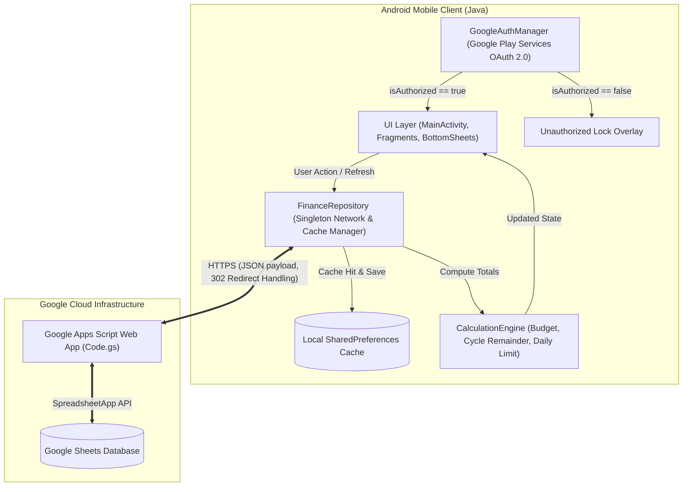
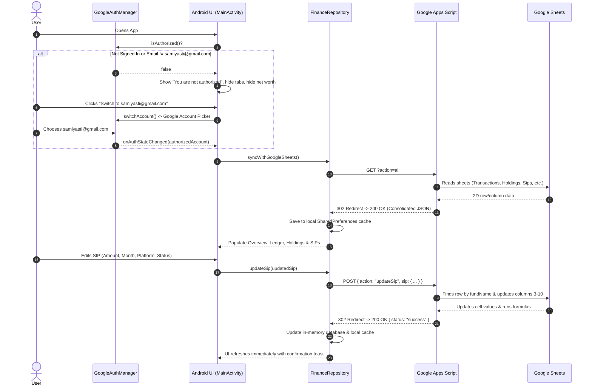
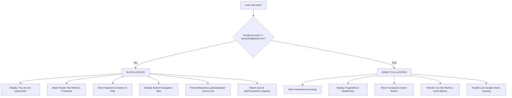

# Finance Manager - Comprehensive Architecture, Design & Developer Guide

A robust, offline-capable native Android application paired with a **Google Sheets REST API backend** (powered by Google Apps Script) to track, forecast, and manage personal wealth, monthly expense cycles, mutual fund portfolios, systematic investment plans (SIPs), and loan liabilities.

---

## Table of Contents
1. [Core Business Considerations & Domain Rules](#1-core-business-considerations--domain-rules)
   - [Google Account Authentication & Strict Authorization](#google-account-authentication--strict-authorization)
   - [Billing Cycle & The 6th-to-5th Rule](#billing-cycle--the-6th-to-5th-rule)
   - [Dual Sub-Category System](#dual-sub-category-system)
   - [SIP Tracer Architecture & Constraints](#sip-tracer-architecture--constraints)
   - [Financial Goals (View Only)](#financial-goals-view-only)
   - [LIC & Tata AIA Policies (Controlled Updates & Add Flow)](#lic--tata-aia-policies)
   - [Insurance Financing Visual Representation (Health & Life Goal vs Policies)](#insurance-financing-visual-representation)
   - [Universal Calendar Date Pickers (dd/MM/yyyy)](#universal-calendar-date-pickers)
   - [Mutual Fund Transactions (Buy vs. Redeem)](#mutual-fund-transactions-buy-vs-redeem)
   - [Sheet Formula Co-existence](#sheet-formula-co-existence)
   - [Overview & Financial KPI Calculations](#overview--financial-kpi-calculations)
   - [Interactive Cycle Analytics Charts (Budget vs Expense vs Investment)](#interactive-cycle-analytics-charts)
   - [App Branding & Visual Identity (FinMngr)](#app-branding--visual-identity-finmngr)
   - [Keyboard & UX Design Considerations](#keyboard--ux-design-considerations)
2. [System Architecture & Data Flow](#2-system-architecture--data-flow)
   - [High-Level Architecture](#high-level-architecture)
   - [End-to-End Data Flow](#end-to-end-data-flow)
   - [Multi-Tier Authorization Flow](#multi-tier-authorization-flow)
   - [Handling Google Apps Script HTTP 302 Redirects](#handling-google-apps-script-http-302-redirects)
3. [Google Sheets Database Schema](#3-google-sheets-database-schema)
4. [Project File Structure](#4-project-file-structure)
5. [Key Components & Responsibilities](#5-key-components--responsibilities)
6. [Debugging & Troubleshooting Guide](#6-debugging--troubleshooting-guide)
   - [Building the Project](#building-the-project)
   - [Testing Google Apps Script Endpoints](#testing-google-apps-script-endpoints)
   - [Inspecting Logcat Logs](#inspecting-logcat-logs)
   - [Common Pitfalls & Fixes](#common-pitfalls--fixes)
7. [Google Apps Script Deployment Guide](#7-google-apps-script-deployment-guide)

---

## 1. Core Business Considerations & Domain Rules

### Google Account Authentication & Strict Authorization
The application manages sensitive personal financial data, investment balances, and live transaction sync. It strictly enforces a single-user security model:
* **Authorized Identity**: Access to view or edit data is exclusively granted to:
  $$\mathbf{samiyasti@gmail.com}$$
* **Multi-Layer Enforcement Architecture**:
  1. **UI Layer (`MainActivity`)**:
     - When not signed in or signed in with any unauthorized Google account:
       - Displays a full-screen blocking overlay (`layoutUnauthorized`) with a red shield/lock icon (`ic_lock.xml`), **"You are not authorized"** title, and context-aware messaging.
       - The active fragment container is completely hidden (`View.GONE`).
       - Bottom navigation tabs are disabled (`setEnabled(false)`).
       - Quick-add Floating Action Button (FAB) is hidden (`View.GONE`).
       - Header Net Worth displays `"Protected"` and Cycle info displays `"Access Restricted"`.
       - Provides a prominent `"Switch to samiyasti@gmail.com"` / `"Sign in with samiyasti@gmail.com"` button to invoke Google Play Services account chooser.
  2. **Dialog & Form Layer**:
     - Every bottom sheet modal (`AddTransactionBottomSheet`, `AddMutualFundTransactionBottomSheet`, `EditSipBottomSheet`, `SipTracerBottomSheet`, `ViewMfTransactionsBottomSheet`) checks `GoogleAuthManager.isAuthorized()` in `onCreateView()`. If unauthorized, it immediately dismisses and displays a warning toast.
  3. **Repository Layer (`FinanceRepository`)**:
     - `getDatabase()` returns `null` when unauthorized, preventing cached financial numbers from leaking into memory or views.
     - All mutation methods (`addTransaction`, `addMutualFundTransaction`, `updateSip`, `updateSipStatus`, `syncWithGoogleSheets`) reject calls immediately with an authorization error callback prior to initiating any network requests.
  4. **Authentication Manager (`GoogleAuthManager`)**:
     - Centralized singleton wrapping Google Play Services `GoogleSignInClient`.
     - Caches `GoogleSignInAccount` and notifies registered listeners (`AuthListener`) on auth state changes.
     - Implements `isAuthorized()` verifying `currentAccount != null && "samiyasti@gmail.com".equalsIgnoreCase(currentAccount.getEmail().trim())`.
     - Implements `switchAccount(activity)` which first calls `signOut()` so Google's native account chooser pops up reliably.

---

### Billing Cycle & The 6th-to-5th Rule
* **The Rule**: Monthly budget cycles run from the **6th of the current month to the 5th of the following month**.
* **Date 1 to 5 Boundary**:
  - Transactions dated between the **1st and 5th of Month M** belong to the **Month M-1 cycle**.
  - Transactions dated between the **6th and 31st of Month M** belong to the **Month M cycle**.
  - *Example*: A transaction on `02/11/2026` belongs to the **October 2026 cycle**, while a transaction on `07/11/2026` belongs to the **November 2026 cycle**.
* **Code Enforcement**: In `Transaction.java` and `CalculationEngine.java`, cycle assignment strictly inspects the numeric day and shifts the effective month:
  ```java
  public boolean isInCycle(int cycleYear, int cycleMonth) {
      int txDay = getDay();
      int txMonth = getMonth(); // 1-12
      int txYear = getYear();

      int effectiveMonth = (txDay < 6) ? (txMonth - 1) : txMonth;
      int effectiveYear = txYear;
      if (effectiveMonth == 0) {
          effectiveMonth = 12;
          effectiveYear--;
      }
      return effectiveYear == cycleYear && effectiveMonth == cycleMonth;
  }
  ```
  *(Never use string matching like `date.contains("11/2026")` because it erroneously assigns Nov 1-5 to the November cycle).*

---

### Dual Sub-Category System
The application distinguishes between two different concepts of "sub-category":

| Dimension | Scope | Examples | Used By |
|---|---|---|---|
| **Fund Asset Sub-Category** | Investment asset class | `Liquid`, `Flexi Cap`, `Small Cap`, `Mid Cap` | AMC classification |
| **Category Tables Sub-Category (Savings Type)** | Budgeting & account allocation | `Kuvera Surplus(Family)`, `Mutual Fund`, `Credit Mutual Fund` | Ledger transactions & Holding badges |

* **Holding Card Badge**: Displays `h.savingsType` (e.g. `Kuvera Surplus(Family)`).
* **Holding Click Filtering**: Clicking on a holding card (e.g. `DSP LIQUID FUND`) opens transaction history filtered by:
  1. Scheme Name / Scheme Code / Scheme Id.
  2. The Category Tables subcategory (`h.savingsType`), **not** the fund asset class (`Liquid`).

---

### SIP Tracer Architecture & Constraints
The SIP Tracer tracks systematic investment commitments across multiple platforms and bank accounts:
* **Dual Month View**: Monitors "This Month's SIP" vs "Next Month's SIP (Final)".
* **Controlled Creation**: New SIP entries **cannot** be added from the mobile app; they require direct Google Sheet entry.
* **Full In-App Modification**: Existing SIPs can be fully modified from the app:
  - This Month Amount & Next Month Amount (Numeric).
  - This Month & Next Month selections (`Jan`, `Feb`, ... `Dec`).
  - Payment Statuses (`Not Paid` / `Paid`).
  - Platform (`amc/upiauto`, `indmoney`, `amc/enach`, `groww`, `NA`).
  - Linked Bank Account (`Slice`, `sbi`, `Pnb`, `Hdfc`, etc.).
* **1-Tap Quick Toggles**: Main list cards have direct `Not Paid` / `Paid` buttons for fast 1-tap toggling without opening the full edit sheet.

---

### Financial Goals (View Only)
* **Design & Security Requirement**: Financial goals represent long-term wealth milestones and savings buckets (e.g. `Health And Life Insurance`, `Emergency Fund`, `Bike`).
* **Strict View-Only Rule**: Financial goals are strictly **view-only**. The mobile UI does not render edit, update, or delete buttons for goals.
* **Tracked Metrics**:
  - **Goal Target Amount**: Total planned fund accumulation (e.g. ₹60,000.00).
  - **Accumulated Balance**: Current sum saved towards the target (e.g. ₹15,190.28).
  - **Achieved Percentage**: Dynamic progress calculation ($$\text{Achieved} = \frac{\text{Current Amount}}{\text{Target Amount}} \times 100$$).
  - **Savings Allocation Percentage**: Planned monthly savings share (e.g. 30% of monthly savings).
  - **Visual Progress Bar**: Horizontal emerald progress bar showing completion toward goal target.

---

### LIC & Tata AIA Policies
The application tracks life and health insurance policies across LIC and Tata AIA Life Insurance:
* **Strict Lockdown Rule**: Per security constraints, existing insurance policies **lock all core financial terms**.
  - **Immutable Fields**: Policy Number, Premium Amount, Sub-Category (LIC / Tata AIA), Category (Life / Health / Motor), Sum Assured, Installments Remaining, Notes.
  - **Mutable Fields**: ONLY **Last Paid Date** and **Due Date** can be edited/updated by the user.
* **Controlled Date Editor (`EditPolicyBottomSheet`)**:
  - Displays a locked policy information header and notice: *"Policy Number, Premium, and Sum Assured are locked per security rules. Only Due Date and Last Paid Date can be updated."*
  - Provides calendar pickers with the dark theme for both dates, auto-formatting to `dd/MM/yyyy`.
  - Sends a secure `POST` action (`action: 'updatePolicy'`) to Google Apps Script which matches by policy number and strictly modifies columns 4 (`Last Paid`) and 5 (`Due Date`).
* **Add Policy Option (`AddPolicyBottomSheet`)**:
  - Allows adding new policies directly to the `LIC AND TATA AIA` Google Sheet.
  - Form fields include: Policy Number, Sub-Category (LIC / Tata AIA modal selector), Premium Amount, Sum Assured, Due Date (Calendar Picker), Last Paid Date (Calendar Picker), Installments Remaining, and Notes.
  - Sends `action: 'addPolicy'` to Google Apps Script, instantly appending to the sheet.

---

### Insurance Financing Visual Representation
* **Business Logic**: The total annual insurance premiums across all active policies are financed by the `Health And Life Insurance` goal fund.
* **Visual Representation Card (Accounts Screen)**:
  - **3-Column KPI Metric Row**:
    1. **Annual Premiums** (Sky Blue `#38BDF8`): Sum of all active policy premiums ($$\sum \text{Policy Premiums} = \text{₹53,694.00}$$).
    2. **Funded in Goal** (Emerald `#34D399`): Accumulated balance in `Health And Life Insurance` goal ($$\text{₹15,190.28}$$).
    3. **Goal Target** (Amber `#F59E0B`): Full target capacity ($$\text{₹60,000.00}$$).
  - **Funding Percentage Badge**:
    $$\text{Funding \%} = \frac{\text{Goal Accumulated}}{\text{Total Annual Premiums}} \times 100 = 28.3\%$$
    - Styled with emerald badge (`bg_badge_good`) if $$\ge 100\%$$, or amber badge (`bg_badge_amber`) if underfunded.
  - **Progress Bar**: Horizontal visual progress bar comparing funded balance against total annual obligations.
  - **Dynamic Remaining Deficit Note**:
    - When underfunded: Displays exact shortage, e.g. *"₹38,503.72 remaining in goal to fully fund annual premiums"*.
    - When fully funded ($$\ge 100\%$$): Displays confirmation *"Annual insurance premiums are 100% funded by your Health & Life Goal!"*.

---

### Universal Custom Calendar Dialog (Full FinMngr Design Language)
* **Design Consistency**: Replaces generic system DatePickerDialog with a purpose-built custom calendar dialog (`CustomCalendarDialog.java` & `dialog_custom_calendar.xml`) designed to strictly match FinMngr's futuristic dark aesthetic:
  - **Container**: Rounded card (`#131B26`, 20dp corner radius, 1dp subtle border `#223247`).
  - **Header**: Calendar icon, title ("Select Date" in `#F8FAFC`), and close button.
  - **Quick Presets**: 1-tap shortcut pills for `[ Today ]`, `[ Yesterday ]`, `[ 6th (Cycle Start) ]`, and `[ 1st of Month ]`.
  - **Navigation**: Month & Year navigation bar (`◀ November 2026 ▶`) with 1-tap Year Picker modal (2020-2035).
  - **7-Column Day Grid**: Day cells with haptic touch feedback. Today's date features a subtle mint ring (`#34D399`), while the selected date is highlighted with a solid emerald green circle (`#10B981`) and bold white text.
  - **Selected Date Preview**: Live preview pill (e.g. `Selected: Sat, 14 Nov 2026`).
  - **Footer Buttons**: Styled `Cancel` (`bg_pill_dark`) and `Set Date` (`bg_pill_emerald`) action buttons.
* **Formatting**: Automatically parses incoming dates and formats selected dates strictly to `dd/MM/yyyy`.
* **Adopted Modals**:
  1. `AddTransactionBottomSheet` (Ledger income/expense date)
  2. `AddMutualFundTransactionBottomSheet` (Mutual fund transaction date)
  3. `EditPolicyBottomSheet` (Policy Last Paid and Due Date)
  4. `AddPolicyBottomSheet` (New Policy Last Paid and Due Date)

---

### Mutual Fund Transactions (Buy vs. Redeem)
* **Buy / SIP**:
  - Positive units.
  - User enters Amount, NAV, and Units.
  - Amount is written to `Actual Invested` (Column 10).
* **Redeem**:
  - Negative units.
  - Amount is left blank or computed via sheet formula.

---

### Sheet Formula Co-existence
To prevent the mobile app from overwriting automated formulas in Google Sheets, specific columns are deliberately left blank in POST requests:
* **Column 1 (`Scheme Name`)**: Left blank so Google Sheet's `=VLOOKUP(Scheme Id, ...)` dynamically resolves the name.
* **Column 9 (`Invested / Redeemed Amount`)**: Left blank so sheet formulas (`=ROUND(Units * NAV, 2)`) calculate values.
* **Column 17 (`Processed`)**: Left blank so automation scripts mark records as `Done`.
* **Column 18 (`Scheme Code`)**: Sent for historical NAV sync lookups.

---

### Overview & Financial KPI Calculations
* **Net Worth Formula**:
  $$\text{Net Worth} = \sum \text{Bank Balances} + \sum \text{Mutual Fund Current Values} - \sum \text{Loan Outstanding}$$
* **Interest Accrued Rule**:
  Accrued interest aggregates bank account interest (`Category == "Interest"` and `Type == "Bank"`). It **strictly excludes** loan interest.
* **Balanced 2x2 Grid**: Overview cards are arranged in an unscrollable 2x2 grid:
  1. Net Worth (Total Valuation, 1D Gain, ROI)
  2. Bank Balances (Liquid funds across Slice, SBI, PNB, HDFC)
  3. Total Assets (Mutual funds, gold, equity)
  4. Loan Debt (Total liabilities)

---

### Interactive Cycle Analytics Charts
The Cycles screen features an interactive multi-series comparison chart (`CycleChartView`) comparing historical and active cycle metrics:
* **Metric Series**:
  - **Budget** (Sky Blue `#38BDF8`)
  - **Total Expense** (Rose Red `#F43F5E`)
  - **Total Investment** (Amber Gold `#F59E0B`)
* **Interactive Touch Scrubbing & Inspector**:
  - Users can tap or drag across cycles with immediate haptic feedback (`HapticFeedbackConstants.CLOCK_TICK`).
  - Active cycle indicator dot (Emerald `#10B981`) flags current billing cycle.
  - Interactive Selected Cycle Detail Card updates in real time with Budget, Actual Spend, % Utilized, Total Invested, and Net Surplus/Deficit.
* **Range & Series Filters**:
  - Filter by **6M** (Last 6 cycles), **1Y** (Last 12 cycles), or **All** historical cycles.
  - Interactive chip toggles allow isolating or hiding individual metric bars (Budget, Expense, Investment).
* **Live Sync**: Active cycle's expense and budget values dynamically reflect live transaction additions from `activeCycle.totalSpend` and `activeCycle.budget`.

---

### Cycle Expense Tracker (Past vs Current Cycle Comparison)
The **Expense Tracker** compares itemized spending and investments between the **past cycle** and **current active cycle**:
* **Savings vs. Expenses Business Rules**:
  - **Category of Saving** (e.g., Mutual Fund, Emergency Fund, US Stocks, NPS, PPF, LIC, Family Savings):
    $$\text{Current Cycle} \ge \text{Past Cycle} \implies \mathbf{Good\ /\ Better} \quad (\text{Emerald Badge: } \text{▲ Saved More})$$
    $$\text{Current Cycle} < \text{Past Cycle} \implies \mathbf{Alert} \quad (\text{Amber Badge: } \text{▼ Less Saved})$$
  - **Other Categories / Expenses** (e.g., Electricity, Food, Transit, House Rent, Mobile Bill, Family Expenses):
    $$\text{Current Cycle} \le \text{Past Cycle} \implies \mathbf{Good\ /\ Better} \quad (\text{Emerald Badge: } \text{▼ Reduced Expense})$$
    $$\text{Current Cycle} > \text{Past Cycle} \implies \mathbf{Alert} \quad (\text{Rose Red Badge: } \text{▲ Higher Expense})$$
* **Interactive Filtering & Summary**:
  - **Filter Tabs**: Toggle between **All Items**, **Savings**, and **Expenses**.
  - **Summary Counters**: Header displays live count of **On-Track/Good** vs. **Alert** items.
  - **Three-Column Metrics**: Each card presents **Current Cycle Cost**, **Past Cycle Cost**, and **Target / Budget** amount.
* **Backend Sync**:
  - Fetched from the `Expense Tracker` sheet in Google Sheets via `Code.gs` (`action=all`).
  - Automatically reconciled with active billing cycle transactions by `CalculationEngine`.

---

### App Branding & Visual Identity (FinMngr)
* **Visual Identity**:
  - **Icon**: Stylized teal/cyan piggy bank with gold coin (`$`), bar chart graphic on body, and upward trending orange arrow inside a deep navy squircle (`#071727`).
  - **Logo Wordmark**: `FinMngr` typography with custom color split (**F** in `#FFFFFF`, **in** in `#1BB5A6`, **Mngr** in `#F59E0B`) with subtitle **SMART WEALTH TRACKING**.
* **Android Launcher Icons**:
  - Vector adaptive foreground icon (`ic_launcher_foreground.png`) with safe-zone margin.
  - Square/squircle (`ic_launcher.png`) and circular (`ic_launcher_round.png`) mipmap assets generated across `mdpi`, `hdpi`, `xhdpi`, `xxhdpi`, and `xxxhdpi`.
  - Dark splash screen (`splash.png`) and branded app bar headers across the app.
* **Auto-Dismiss Keyboard**: Tapping anywhere outside of numeric input fields (card backgrounds, labels, containers, or scrolling) immediately closes the software keyboard.
* **No Floating Dropdowns**: Standard Android dropdown spinners have been replaced with centered modal dialogs (`AlertDialog.Builder`) for Month, Platform, and Bank selection to prevent coordinate bugs or keyboard overlap.
* **Full Sheet Expansion**: Bottom sheets use `BottomSheetBehavior.STATE_EXPANDED` and `SOFT_INPUT_ADJUST_RESIZE` so inputs and action buttons remain visible above the software keyboard.

---

## 2. System Architecture & Data Flow

### High-Level Architecture



---

### End-to-End Data Flow



---

### Multi-Tier Authorization Flow



---

### Handling Google Apps Script HTTP 302 Redirects
When calling Google Apps Script Web Apps with a `POST` method:
1. Google responds with `HTTP 302 Found` pointing to `https://script.googleusercontent.com/macros/echo?...`.
2. Standard Android `HttpURLConnection` does not automatically follow redirects for POST requests.
3. `FinanceRepository.executeHttpPost()` explicitly handles `302/303` redirect codes, reading the `Location` header and completing the request.

---

## 3. Google Sheets Database Schema

The Google Spreadsheet acts as the relational database across 10 specialized sheets:

| Sheet Name | Key Columns | Purpose |
|---|---|---|
| **Transactions** | Date, Credit, Debit, Net, Remainder, Sub Category, Type, Loans, Account, Category, Year, Month | General ledger of all income and expenses |
| **Mutual Investment Holdings** | Scheme Name, Scheme Code, Scheme Id, Category, Sub-category, Savings Type, Units, Avg Buying NAV, Invested Value, NAV, Current Value, 1D Change | Current portfolio valuation and live NAV tracking |
| **Mutual Fund Transactions** | Scheme Name, Scheme Id, Date, Fund Category, Fund Sub Category, Platform, Sub Category, Folio, Actual Invested, Units, NAV, Processed, Scheme Code | Detailed mutual fund transaction ledger (Buy/Redeem) |
| **SIP Tracer** | Fund Name, Role in Architecture, This Month's SIP, This Month, Payment Status, Next SIP (Final), Next Month, Next Month's Payment Status, Linked Bank Account, Platform | Monthly SIP deployment roadmap and status |
| **Current Account Balance** | Accounts, Current Balance | Liquid bank account balances |
| **Current Loan OutStanding** | Loans, Current OutStanding, Interest Rate, IsDebt | Liabilities and debt tracking |
| **Budget** | Year, Month, Month Number, BUDGET, Spend, Remainder, Can Spend Per Day, Investment | Budget limits and daily spending allowances |
| **Category Tables** | Category Name, SubCategory | Category hierarchy definitions |
| **Goals** | Goals Name, Goal Amount, Occured Till Date, Percentage Of saving To Put | Long-term savings goals (View Only in app) |
| **LIC AND TATA AIA** | Policy Number, Birth Date, Amount, Last Paid, Due Date, Last Date, Installment Remains, Sub Category, Category, Id, Password, Sum Assured, Notes | Insurance policy master ledger (13 columns). Only Last Paid and Due Date mutable in-app |

---

## 4. Project File Structure

```
Finance-Manager/
├── .gitignore                          # Root ignore rules (build, gradle, IDE, apk)
├── FinanceManager.apk                  # Current ready-to-install debug build
├── README.md                           # This architecture and developer guide
├── google-apps-script/
│   └── Code.gs                         # Google Apps Script Web App REST API gateway
└── finance-android/
    ├── build.gradle                    # Top-level Gradle configuration
    ├── gradlew / gradlew.bat           # Gradle wrapper scripts
    └── app/
        ├── build.gradle                # App module build configuration
        └── src/main/
            ├── AndroidManifest.xml     # App manifest (INTERNET permission, MainActivity)
            ├── java/com/samiy/financemanager/
            │   ├── MainActivity.java   # Main navigation activity (BottomNav & Auth Guard)
            │   ├── auth/
            │   │   └── GoogleAuthManager.java # Google Play Services OAuth & Authorization logic
            │   ├── data/
            │   │   ├── FinanceRepository.java  # Core network client, cache & Google API sync
            │   │   └── model/                  # Data models (Gson serialized)
            │   │       ├── Account.java        # Bank account balance DTO
            │   │       ├── BudgetItem.java     # Budget & spend limits DTO
            │   │       ├── CategoryItem.java   # Category & subcategories DTO
            │   │       ├── CurrentCycle.java   # Billing cycle metadata DTO
            │   │       ├── FinanceDatabase.java# Consolidated in-memory database DTO
            │   │       ├── Holding.java        # Portfolio investment holding DTO
            │   │       ├── Loan.java           # Liability DTO
            │   │       ├── MutualFundTransaction.java # MF transaction DTO
            │   │       ├── PortfolioSummary.java # Portfolio aggregated ROI DTO
            │   │       ├── SavingsTypeSummary.java # Savings category breakdown DTO
            │   │       ├── SipItem.java        # SIP Tracer item DTO
            │   │       └── Transaction.java    # General ledger entry DTO
            │   ├── engine/
            │   │   └── CalculationEngine.java  # Remainder, spend limit & interest aggregations
            │   ├── ui/
            │   │   ├── adapter/
            │   │   │   ├── AccountsAdapter.java
            │   │   │   ├── HoldingsAdapter.java
            │   │   │   ├── MfTransactionsAdapter.java
            │   │   │   ├── SipAdapter.java # SIP card adapter with 1-tap status buttons
            │   │   │   └── TransactionsAdapter.java
            │   │   ├── dialog/
            │   │   │   ├── AddMutualFundTransactionBottomSheet.java # Auth-guarded MF creator
            │   │   │   ├── AddTransactionBottomSheet.java           # Auth-guarded general tx
            │   │   │   ├── EditSipBottomSheet.java                  # Full SIP parameter editor
            │   │   │   ├── SipTracerBottomSheet.java                # SIP list & quick status toggler
            │   │   │   └── ViewMfTransactionsBottomSheet.java       # MF ledger filtered by holding
            │   │   └── fragment/
            │   │       ├── AccountsFragment.java
            │   │       ├── CycleFragment.java
            │   │       ├── HoldingsFragment.java   # Portfolio summary & scheme cards
            │   │       ├── LedgerFragment.java     # Transaction history with cycle filtering
            │   │       └── OverviewFragment.java   # 2x2 financial KPI dashboard
            │   └── util/
            │       └── DateTimeHelper.java     # Date parsing (dd/MM/yyyy) & cycle utilities
            └── res/
                ├── drawable/                   # Dark theme backgrounds, chips & pills
                │   ├── ic_lock.xml             # Security padlock vector for auth screen
                │   ├── ic_google.xml           # Multi-color official Google 'G' icon
                │   └── ...
                ├── layout/                     # XML layout resources
                │   ├── activity_main.xml       # Main layout with Unauthorized blocking overlay
                │   ├── dialog_edit_sip.xml     # Clean edit dialog with touch interceptor
                │   ├── dialog_sip_tracer.xml   # SIP Tracer bottom sheet
                │   ├── dialog_view_mf_transactions.xml
                │   ├── fragment_holdings.xml   # Balanced 2x2 action buttons
                │   ├── fragment_overview.xml   # 2x2 KPI card grid
                │   ├── item_holding.xml
                │   ├── item_sip.xml
                │   └── item_transaction.xml
                └── values/
                    ├── colors.xml              # Futuristic dark palette (#0B0F19, emerald, red)
                    ├── strings.xml
                    └── styles.xml              # AppTheme & CustomDarkDialog definitions
```

---

## 5. Key Components & Responsibilities

| Component | Responsibility |
|---|---|
| `GoogleAuthManager` | Manages Google Sign-In with Google Play Services (`GoogleSignInClient`). Validates authorization against `samiyasti@gmail.com`, notifies listeners on login/logout, and provides safe account switching. |
| `MainActivity` | Orchestrates the primary UI, bottom navigation tabs, Floating Action Button, and enforces the `layoutUnauthorized` blocking screen when unauthorized. |
| `FinanceRepository` | Singleton managing network requests via thread pools, parsing responses, saving local cache to `SharedPreferences`, enforcing authorization checks, and notifying callbacks on the Android main thread. |
| `CalculationEngine` | Computes net inflow/outflow, total debit/credit, remaining budget, days remaining in cycle, daily spend allowance, and filters interest transactions. |
| `AccountsFragment` | Renders bank balances, liabilities/debt, section filter pills (All, Banks & Debt, LIC & Tata AIA, Financial Goals), Insurance Financing visual representation card, insurance policy list with date updates and add policy action, and view-only financial goals. |
| `EditPolicyBottomSheet` | Bottom sheet for updating insurance policies. Strictly enforces lockdown on policy terms; only Last Paid Date and Due Date can be modified via dark-themed calendar pickers. |
| `AddPolicyBottomSheet` | Bottom sheet for adding new insurance policies to Google Sheets with calendar pickers for dates and provider modal selector. |
| `CustomCalendarDialog` | Custom dark-themed calendar dialog with 1-tap quick presets (Today, Yesterday, 6th Cycle Start, 1st of Month), month/year navigation, and day grid adhering to FinMngr design language. |
| `DateTimeHelper` | Central utility delegating date selections to `CustomCalendarDialog` and managing date parsing/formatting in `dd/MM/yyyy`. |
| `HoldingsFragment` | Renders portfolio KPIs (total invested, current valuation, 1D gain, ROI), savings type breakdown, and the list of holdings. |
| `ViewMfTransactionsBottomSheet` | Displays mutual fund transaction history. Filters by Scheme Name/Id/Code and Category Tables Sub-Category (`Kuvera Surplus(Family)`). Protected by authorization checks. |
| `SipTracerBottomSheet` | Displays active SIP schemes, total monthly outlay, quick `Paid`/`Not Paid` toggle buttons, and opens the full editor. Protected by authorization checks. |
| `EditSipBottomSheet` | Edits SIP amounts, months, payment statuses, platforms, and linked bank accounts with auto-dismiss keyboard touch listeners. Protected by authorization checks. |
| `LedgerFragment` | Full transaction history with cycle dropdown selector, account filtering, and debit/credit summaries. |

---

## 6. Debugging & Troubleshooting Guide

### Building the Project
From the `finance-android` directory:
```powershell
Set-Location "finance-android"
./gradlew assembleDebug --no-daemon
```
The generated APK is located at:
`C:\Users\samiy\AppData\Local\Temp\FinanceManagerBuild\app\outputs\apk\debug\app-debug.apk`
*(And automatically mirrored to `FinanceManager.apk` in the repository root).*

---

### Testing Google Apps Script Endpoints
To verify the live Google Apps Script Web App without running the Android app:

#### 1. Test GET (Fetch Entire Database):
```bash
node -e "fetch('YOUR_GAS_URL?action=all', {redirect: 'follow'}).then(r => r.json()).then(d => console.log('Keys:', Object.keys(d.data), 'SIPs count:', d.data.sips.length))"
```

#### 2. Test POST (Update a SIP Parameter):
```javascript
fetch('YOUR_GAS_URL', {
  method: 'POST',
  headers: { 'Content-Type': 'application/json' },
  body: JSON.stringify({
    action: 'updateSip',
    sip: {
      fundName: 'Invesco India Mid Cap',
      currentSip: 5250,
      currentMonth: 'Nov',
      currentStatus: 'Paid',
      nextSip: 5250,
      nextMonth: 'Dec',
      nextStatus: 'Not Paid',
      bankAccount: 'Slice',
      platform: 'groww'
    }
  }),
  redirect: 'follow'
}).then(r => r.json()).then(console.log);
```

---

### Inspecting Logcat Logs
Connect your device over ADB and filter by app tags:
```bash
adb logcat -s FinanceRepository CalculationEngine GoogleAuthManager MainActivity
```

---

### Common Pitfalls & Fixes

1. **"You are not authorized" Shown When Opening the App**:
   - *Cause*: User is not logged into Google, or logged into another email account instead of `samiyasti@gmail.com`.
   - *Fix*: Tap the **"Switch to samiyasti@gmail.com"** or **"Sign in with samiyasti@gmail.com"** button and select the authorized account.
   - *Google Play Services API Error*: Ensure your debug SHA-1 signing fingerprint is registered in Google Cloud Console OAuth 2.0 Client IDs for package `com.samiy.financemanager`.

2. **Transactions on Date 1-5 Appearing in Wrong Cycle**:
   - *Cause*: String matching on date (e.g. `date.contains("11/2026")`).
   - *Fix*: Always use `Transaction.isInCycle(cycleYear, cycleMonth)` which checks `day < 6 ? month - 1 : month`.

3. **SIP Updates Not Reflected in Google Sheet**:
   - *Cause*: Google Apps Script deployment was not updated after changes to `Code.gs`.
   - *Fix*: In Google Sheets, go to **Extensions > Apps Script**, paste the updated `Code.gs`, and click **Deploy > New deployment**.

4. **Software Keyboard Blocks Dialog Fields or Buttons**:
   - *Cause*: Missing `SOFT_INPUT_ADJUST_RESIZE` or bottom sheet collapsing.
   - *Fix*: Call `behavior.setState(STATE_EXPANDED)`, `behavior.setSkipCollapsed(true)`, and set `dialog.getWindow().setSoftInputMode(SOFT_INPUT_ADJUST_RESIZE)`.

5. **Dropdown Menus Flying to the Top of the Screen**:
   - *Cause*: Standard Android `Spinner` calculates popup coordinates incorrectly in scrollable bottom sheets.
   - *Fix*: Use centered modal dialogs (`AlertDialog.Builder`) for picking months, platforms, and banks.

6. **Mutual Fund Transactions Missing for a Holding**:
   - *Cause*: Filtering by Fund Sub-Category (e.g. `Liquid`) instead of Category Tables Sub-Category (e.g. `Kuvera Surplus(Family)`).
   - *Fix*: Pass `h.savingsType` to `ViewMfTransactionsBottomSheet.newInstance(...)`.

---

## 7. Google Apps Script Deployment Guide

Whenever modifying `Code.gs`:
1. Open the [Finance Report Google Sheet](https://docs.google.com/spreadsheets/d/1IUekkxG3Au1ZBO5wOkk8Tit6ZZAuLhjiJjlKpTaUg_A/edit).
2. Click **Extensions** > **Apps Script**.
3. Replace the entire code with the contents of `google-apps-script/Code.gs`.
4. Click **Deploy** > **Manage deployments** (or **New deployment**).
5. Configuration:
   - **Type**: Web app
   - **Execute as**: `Me` (your Google account)
   - **Who has access**: `Anyone`
6. Click **Deploy**.
7. If the URL changes, update `GAS_URL` in `FinanceRepository.java`.
