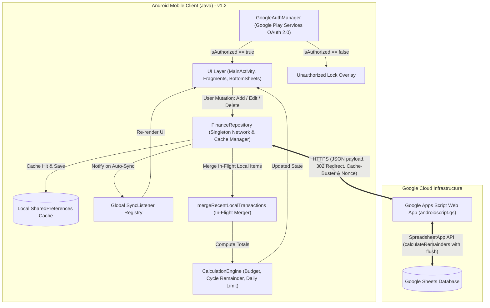
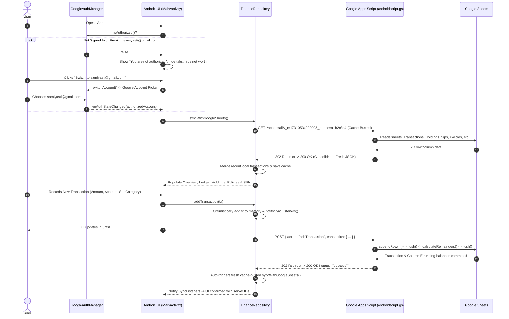
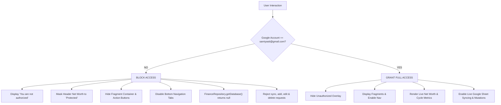

# Finance Manager - Comprehensive Architecture, Design & Developer Guide

A robust, offline-capable native Android application paired with a **Google Sheets REST API backend** (powered by Google Apps Script via `androidscript.gs`) to track, forecast, and manage personal wealth, monthly expense cycles, mutual fund portfolios, systematic investment plans (SIPs), insurance policies, and loan liabilities.

**Version:** `2.1` (`versionCode 12`)  
**Target SDK:** `Android 14 (API 34)` | **Min SDK:** `Android 8.0 (API 26)`  
**Ready-to-Install APK:** `FinanceManager.apk` (located in the repository root)


> [!TIP]
> **Quick Build One-Liner (Windows PowerShell):**
> ```powershell
> cd finance-android; .\gradlew.bat assembleDebug; Copy-Item "C:\Users\samiy\AppData\Local\Temp\FinanceManagerBuild\app\outputs\apk\debug\app-debug.apk" -Destination "..\FinanceManager.apk" -Force; cd ..
> ```
> The freshly compiled ready-to-install binary is always maintained at the repository root as [**`FinanceManager.apk`**](file:///c:/Users/samiy/OneDrive/Documents/projects/android/Finance-Manager/FinanceManager.apk).

---

## Table of Contents
1. [Core Business Considerations & Domain Rules](#1-core-business-considerations--domain-rules)
   - [Google Account Authentication & Strict Authorization](#google-account-authentication--strict-authorization)
   - [Billing Cycle & The 6th-to-5th Rule](#billing-cycle--the-6th-to-5th-rule)
   - [Zero-Latency Sync Engine & Cache-Busting Architecture](#zero-latency-sync-engine--cache-busting-architecture)
   - [Transaction Lifecycle: Add & Delete Only Architecture](#transaction-lifecycle-add--delete-only-architecture)
   - [Running Balance (Remainder) Synchronization & Account Reconciliation](#running-balance-remainder-synchronization--account-reconciliation)
   - [Dual Sub-Category System](#dual-sub-category-system)
   - [SIP Tracer Architecture & Constraints](#sip-tracer-architecture--constraints)
   - [Financial Goals Management & Dynamic Allocations](#financial-goals-management)
   - [LIC & Tata AIA Policies (Controlled Updates, 'Mark as Paid' & Add Flow)](#lic--tata-aia-policies)
   - [Credit Cards Management (Billed vs Unbilled, Adding Cards & 1-Month Due Date Advance)](#credit-cards-management)
   - [Upcoming Due Date Reminders & Automated Daily System Notifications](#upcoming-due-date-reminders--daily-notifications)
   - [Insurance Financing Visual Representation (Health & Life Goal vs Policies)](#insurance-financing-visual-representation)
   - [Universal Custom Calendar Dialog V2 (Decades Quick-Jump & Min/Max Constraints)](#universal-custom-calendar-dialog-v2)
   - [Mutual Fund Transactions (Buy vs. Redeem)](#mutual-fund-transactions-buy-vs-redeem)
   - [Sheet Formula Co-existence](#sheet-formula-co-existence)
   - [Overview & Financial KPI Calculations](#overview--financial-kpi-calculations)
   - [Interactive Cycle Analytics Charts (Budget vs Expense vs Investment)](#interactive-cycle-analytics-charts)
   - [Cycle Expense Tracker (Past vs Current Cycle Comparison)](#cycle-expense-tracker-past-vs-current-cycle-comparison)
   - [App Branding & UX Modernization (Contextual Actions & Keyboard Handling)](#app-branding--ux-modernization)
   - [Pastel Color Design System & Dynamic Theme Toggle (Dark & Light Pastel)](#pastel-color-design-system--dynamic-theme-toggle)
   - [Instant Optimistic Updates & Global Visual Sync Feedback Engine](#instant-optimistic-updates--global-visual-sync-feedback-engine)
   - [Unified Modal & Dialog Design Language (FinMngrDialog & Pill Buttons)](#unified-modal--dialog-design-language)
   - [Universal In-App Floating Toaster HUD (FinMngrToast)](#universal-in-app-floating-toaster-hud)
2. [System Architecture & Data Flow](#2-system-architecture--data-flow)
   - [High-Level Architecture](#high-level-architecture)
   - [End-to-End Data Flow](#end-to-end-data-flow)
   - [Multi-Tier Authorization Flow](#multi-tier-authorization-flow)
   - [Handling Google Apps Script HTTP 302 Redirects](#handling-google-apps-script-http-302-redirects)
3. [Google Sheets Database Schema](#3-google-sheets-database-schema)
4. [Project File Structure](#4-project-file-structure)
5. [Key Components & Responsibilities](#5-key-components--responsibilities)
6. [Building & Packaging the Android APK (Step-by-Step Guide)](#6-building--packaging-the-android-apk-step-by-step-guide)
   - [Prerequisites & Toolchain Setup](#prerequisites--toolchain-setup)
   - [Environment Variables Configuration](#environment-variables-configuration)
   - [Step-by-Step Build Commands (Windows PowerShell / CMD)](#step-by-step-build-commands-windows-powershell--cmd)
   - [Step-by-Step Build Commands (macOS / Linux / Bash)](#step-by-step-build-commands-macos--linux--bash)
   - [Understanding the Custom Build Directory Architecture](#understanding-the-custom-build-directory-architecture)
   - [Device Installation via ADB or Direct Transfer](#device-installation-via-adb-or-direct-transfer)
   - [Common Build Errors & Troubleshooting](#common-build-errors--troubleshooting)
7. [Debugging & Troubleshooting Guide](#7-debugging--troubleshooting-guide)
   - [Testing Google Apps Script Endpoints](#testing-google-apps-script-endpoints)
   - [Inspecting Logcat Logs](#inspecting-logcat-logs)
   - [Common Pitfalls & Fixes](#common-pitfalls--fixes)
8. [Google Apps Script Deployment Guide (`androidscript.gs`)](#8-google-apps-script-deployment-guide)
9. [Project Changelog (`CHANGELOG.md`)](#9-project-changelog)

---

## 1. Core Business Considerations & Domain Rules

### Google Account Authentication & Strict Authorization
The application manages sensitive personal financial data, investment balances, and live transaction sync. It strictly enforces a single-user security model:
* **Authorized Identity**: Access to view or edit data is exclusively granted to:
  $$\mathbf{samiyasti@gmail.com}$$
* **Multi-Layer Enforcement Architecture**:
  1. **UI Layer (`MainActivity`)**:
     - When not signed in or signed in with any unauthorized Google account:
       - Displays a full-screen blocking overlay (`layoutUnauthorized`) with a red shield/lock icon (`ic_lock.xml`), **"You are not authorized"** title, and context-aware messaging.
       - The active fragment container is completely hidden (`View.GONE`).
       - Bottom navigation tabs are disabled (`setEnabled(false)`).
       - Contextual action buttons are disabled.
       - Header Net Worth displays `"Protected"` and Cycle info displays `"Access Restricted"`.
       - Provides a prominent `"Switch to samiyasti@gmail.com"` / `"Sign in with samiyasti@gmail.com"` button to invoke Google Play Services account chooser.
  2. **Dialog & Form Layer**:
     - Every bottom sheet modal (`AddTransactionBottomSheet`, `AddMutualFundTransactionBottomSheet`, `EditSipBottomSheet`, `SipTracerBottomSheet`, `ViewMfTransactionsBottomSheet`, `EditPolicyBottomSheet`, `AddPolicyBottomSheet`) checks `GoogleAuthManager.isAuthorized()` in `onCreateView()`. If unauthorized, it immediately dismisses and displays a warning toast.
  3. **Repository Layer (`FinanceRepository`)**:
     - `getDatabase()` returns `null` when unauthorized, preventing cached financial numbers from leaking into memory or views.
     - All mutation methods (`addTransaction`, `deleteTransaction`, `addMutualFundTransaction`, `updateSip`, `updateSipStatus`, `updatePolicy`, `addPolicy`, `syncWithGoogleSheets`) reject calls immediately with an authorization error callback prior to initiating any network requests.
  4. **Authentication Manager (`GoogleAuthManager`)**:
     - Centralized singleton wrapping Google Play Services `GoogleSignInClient`.
     - Caches `GoogleSignInAccount` and notifies registered listeners (`AuthListener`) on auth state changes.
     - Implements `isAuthorized()` verifying `currentAccount != null && "samiyasti@gmail.com".equalsIgnoreCase(currentAccount.getEmail().trim())`.
     - Implements `switchAccount(activity)` which first calls `signOut()` so Google's native account chooser pops up reliably.

---

### Billing Cycle & The 6th-to-5th Rule
* **The Rule**: Monthly budget cycles run from the **6th of the current month to the 5th of the following month**.
* **Date 1 to 5 Boundary**:
  - Transactions dated between the **1st and 5th of Month M** belong to the **Month M-1 cycle**.
  - Transactions dated between the **6th and 31st of Month M** belong to the **Month M cycle**.
  - *Example*: A transaction on `02/11/2026` belongs to the **October 2026 cycle**, while a transaction on `07/11/2026` belongs to the **November 2026 cycle**.
* **Code Enforcement**: In `Transaction.java` and `CalculationEngine.java`, cycle assignment strictly inspects the numeric day and shifts the effective month:
  ```java
  public boolean isInCycle(int cycleYear, int cycleMonth) {
      int txDay = getDay();
      int txMonth = getMonth(); // 1-12
      int txYear = getYear();

      int effectiveMonth = (txDay < 6) ? (txMonth - 1) : txMonth;
      int effectiveYear = txYear;
      if (effectiveMonth == 0) {
          effectiveMonth = 12;
          effectiveYear--;
      }
      return effectiveYear == cycleYear && effectiveMonth == cycleMonth;
  }
  ```
  *(Never use string matching like `date.contains("11/2026")` because it erroneously assigns Nov 1-5 to the November cycle).*

---

### Zero-Latency Sync Engine & Cache-Busting Architecture
Google Apps Script Web Apps sit behind Google Front End (GFE) edge proxies, and mobile network carriers (e.g. Jio, Airtel) operate aggressive intermediate forward caching. Under default HTTP configurations, static `GET` requests (`/exec?action=all`) were cached for **5 to 10 minutes (300–600s TTL)**, causing newly entered or sheet-edited transactions to appear delayed. 

To eliminate this delay completely and ensure instant sync, the following end-to-end pipeline was engineered:

1. **Client-Side Dynamic Cache-Busting (`FinanceRepository.java`)**:
   Every sync request appends both high-resolution millisecond timestamps and unique cryptographic tokens:
   ```java
   long ts = System.currentTimeMillis();
   String nonce = UUID.randomUUID().toString().substring(0, 8);
   String url = GAS_URL + "?action=all&_t=" + ts + "&_nonce=" + nonce;
   ```
   Because the URI is mathematically unique on every request, edge CDNs, intermediate cellular caches, and Android's internal `HttpURLConnection` cache are completely bypassed.

2. **Strict HTTP Cache Control Headers**:
   Both `executeHttpGetWithRedirect` and `executeHttpPost` explicitly inject no-cache directives:
   ```java
   conn.setUseCaches(false);
   conn.setDefaultUseCaches(false);
   conn.setRequestProperty("Cache-Control", "no-cache, no-store, max-age=0, must-revalidate");
   conn.setRequestProperty("Pragma", "no-cache");
   conn.setRequestProperty("Expires", "0");
   ```

3. **Optimistic In-Memory Preservation (`mergeRecentLocalTransactions`)**:
   When a user records a transaction in the app, it is instantly inserted into memory (`database.transactions.add(0, tx)`) with a high temporary ID (`System.currentTimeMillis()`), and `notifySyncListeners()` is called immediately. If a subsequent background sync returns before the Google Sheets replica has propagated the new row, `mergeRecentLocalTransactions()` retains the in-flight local transaction so it **never flickers or disappears** from the UI.

4. **Server-Side Flush Pipeline (`calculateRemainders()` & `androidscript.gs`)**:
   - Google Sheets operates an asynchronous write-behind buffer. When `sheet.appendRow()` or `range.setValues()` is invoked, rows sit in memory before being committed to sheet storage.
   - `SpreadsheetApp.flush()` is called at the beginning of `calculateRemainders()` so `transSheet.getLastRow()` immediately recognizes newly appended rows.
   - `SpreadsheetApp.flush()` is called at the end of `calculateRemainders()` after batch-writing Column E, guaranteeing all data and running balances are committed to the spreadsheet before returning the HTTP 200 JSON response.

---

### Transaction Lifecycle: Add & Delete Only Architecture
To safeguard financial audit integrity, prevent historical balance corruption, and match accounting standard practices, transaction editing/updating has been permanently removed. Transactions can strictly be **added** or **deleted**:

1. **Adding Transactions (`AddTransactionBottomSheet`)**:
   - Supports **Expense** (records debit), **Income** (records credit), and **Do not Consider / Account Transfer** (records debit or credit without impacting budget metrics).
   - Date selection powered by `CustomCalendarDialog` (defaults to today's date).
   - Autocomplete and modal search picker for Sub-Categories populated from live category tables.
   - Source selector dynamically switches between **Accounts** (PNB, HDFC, etc.) and **Loans** (CREDIT CARD, SLICE CREDIT, etc.) with real-time balance displays.
   - Automatically populates Year and Month columns as numeric integers matching the 6th-to-5th cycle rule.
   - Immediate optimistic local insertion into `FinanceRepository` for zero perceived latency.

2. **Viewing Details & Deleting Transactions (`LedgerFragment` & `TransactionDetailsBottomSheet`)**:
   - **Transaction Details Modal on Card Click**:
     - Tapping any transaction card displays its complete metadata in a futuristic dark bottom sheet modal (`TransactionDetailsBottomSheet.java` & `dialog_transaction_details.xml`).
     - Details include: Hero amount with signed color coding, transaction type badge, balancing out flag, date & cycle label, source account/loan, tagged credit card badge, full category/sub-category breakdown, running remainder, and Google Sheets row ID.
   - **Deletion via Dedicated Delete Button**:
     - To delete a transaction, the user must explicitly click the **"🗑️ Delete Transaction"** button in the details modal or the **"🗑️ Delete"** button on the card.
     - Tapping the card body solely opens the details view, preventing unintended deletions.
   - **Automatic Credit Card Spend Reversal**:
     - If the deleted transaction was tagged to a credit card, FinMngr automatically and accurately reverses its effect on the card's unbilled statement:
       $$\text{Unbilled Amount}_{\text{new}} = \max(0, \text{Unbilled Amount}_{\text{current}} - \text{Spend Delta})$$
     - Reversal applies instantly in local in-memory state and synchronizes to Google Sheets `Credit Cards` tab.
   - **Instant In-Progress Visual Feedback**:
     - The target transaction card's opacity immediately dims to **35% alpha**.
     - A strike-through is drawn across the transaction amount (`Paint.STRIKE_THRU_TEXT_FLAG`).
     - The button changes from `"🗑️ Delete"` to `"⏳ Deleting..."` with clicks disabled.
     - The swipe-to-refresh sync spinner activates at the top (`swipeRefresh.setRefreshing(true)`).
     - A Toast displays `"Deleting transaction from Google Sheet..."`.
   - The server deletes the specified row, reverses credit card unbilled spends, invokes `calculateRemainders()`, executes `SpreadsheetApp.flush()`, and returns confirmation.
   - Upon confirmation, the card smoothly disappears from the list, the spinner stops, and a success Toast confirms deletion.

3. **Resilient Deserialization & Zero-Latency Sync Engine**:
   - **Lenient Numeric TypeAdapters**: Custom `SAFE_INT_DESERIALIZER`, `SAFE_DOUBLE_DESERIALIZER`, and `SAFE_LONG_DESERIALIZER` in `FinanceRepository` guarantee that empty cells (`""`), whitespace, or currency formatted strings in any sheet column will never trigger `JsonSyntaxException: NumberFormatException: empty String`.
   - **Apps Script Inferred Typing**: `getTransactions` in `androidscript.gs` automatically ensures `year` and `month` are converted to integers (inferring from `dateVal` if empty in the sheet), preventing deserialization crashes that previously caused newly added transactions to show `₹0` or take 5-10 minutes to appear.
   - **Immediate Persistence**: Both `addTransaction` and `deleteTransaction` execute `calculateRemainders()` followed immediately by `SpreadsheetApp.flush()`, ensuring spreadsheet computations are committed before the response returns.

4. **Simplified Ledger Display**:
   - `TransactionsAdapter` displays the exact net amount with color-coded badges (`#34D399` for positive credit, `#F43F5E` for debit/expenses), source badge (Account/Loan), category description, and running remainder.

---

### Running Balance (Remainder) Synchronization & Account Reconciliation
* **Chronological Balance Integrity**:
  - Remainder represents the running balance of a bank account or outstanding balance of a loan after each transaction.
  - Toggling between Credit and Debit or editing historical transactions no longer corrupts balances.
* **Dual Opening Balance Feeds**:
  - Initial balances are sourced from `Account Opening Balance` and `Loans Opening Balance` sheets.
* **Server-Side Recalculation (`calculateRemainders()`)**:
  - `androidscript.gs` incorporates a batch recalculation routine that processes rows chronologically per account and per loan, correctly computing:
    $$\text{Balance}_{t} = \text{Balance}_{t-1} + \text{Credit} + \text{Debit} \quad (\text{Debit is signed negative})$$
  - Batch-updates Column E (`Remainder`) across the entire `Transactions` sheet in a single API operation.

---

### Dual Sub-Category System
The application distinguishes between two different concepts of "sub-category":

| Dimension | Scope | Examples | Used By |
|---|---|---|---|
| **Fund Asset Sub-Category** | Investment asset class | `Liquid`, `Flexi Cap`, `Small Cap`, `Mid Cap` | AMC classification |
| **Category Tables Sub-Category (Savings Type)** | Budgeting & account allocation | `Kuvera Surplus(Family)`, `Mutual Fund`, `Credit Mutual Fund` | Ledger transactions & Holding badges |

* **Holding Card Badge**: Displays `h.savingsType` (e.g. `Kuvera Surplus(Family)`).
* **Holding Click Filtering**: Clicking on a holding card (e.g. `DSP LIQUID FUND`) opens transaction history filtered by:
  1. Scheme Name / Scheme Code / Scheme Id.
  2. The Category Tables subcategory (`h.savingsType`), **not** the fund asset class (`Liquid`).

---

### SIP Tracer Architecture & Constraints
The SIP Tracer tracks systematic investment commitments across multiple platforms and bank accounts:
* **Dual Month View**: Monitors "This Month's SIP" vs "Next Month's SIP (Final)".
* **Controlled Creation**: New SIP entries **cannot** be added from the mobile app; they require direct Google Sheet entry.
* **Full In-App Modification**: Existing SIPs can be fully modified from the app:
  - This Month Amount & Next Month Amount (Numeric).
  - This Month & Next Month selections (`Jan`, `Feb`, ... `Dec`).
  - Payment Statuses (`Not Paid` / `Paid`).
  - Platform (`amc/upiauto`, `indmoney`, `amc/enach`, `groww`, `NA`).
  - Linked Bank Account (`Slice`, `sbi`, `Pnb`, `Hdfc`, etc.).
* **1-Tap Quick Toggles**: Main list cards have direct `Not Paid` / `Paid` buttons for fast 1-tap toggling without opening the full edit sheet.

---

### Financial Goals Management & Dynamic Allocations
* **Dynamic Multi-Asset Schema (`Goals` Sheet)**:
  - Columns: `Goals Name`, `Goal Amount`, `Occured Till Date`, `Achived Till Date`, `Contribution JSON`.
  - Replaces legacy hardcoded savings percentages with a flexible `Contribution JSON` mapping architecture that links each goal to specific Bank Accounts (e.g. `HDFC SAVINGS`, `PNB`, `SBI`) and Mutual Funds (e.g. `Mutual Fund`, `Family Savings`, `Emergency Mutual Fund`) along with their respective contribution weighting percentages (e.g. `1.0`, `0.3`).
* **Dynamic Recalculation Engine (`CalculationEngine`)**:
  - Replicates Google Sheets `MAP` / `LAMBDA` array formulas in local Android logic, evaluating live account balances and current mutual fund valuations in real time to calculate accumulated funds and percentage achieved even when operating offline.
  - Linked Asset Summary: Automatically resolves and displays human-readable contribution sources on each goal card (e.g. `Linked: HDFC SAVINGS, PNB • MF (30%)`).
* **Add Goal Workflow (`AddGoalBottomSheet`)**:
  - Tapping `[＋ Add Goal]` in the Financial Goals header opens an intuitive creation modal.
  - Users provide Goal Name, Target Amount, Initial Amount (optional), and choose a Contribution Asset Linker:
    - **Manual Asset Allocation**: Allocates an explicit rupee contribution without auto-linking.
    - **Link to Bank Account**: Dynamically selects an active bank account (100% balance allocation).
    - **Link to Mutual Fund Category**: Selects a mutual fund savings category with a configurable contribution percentage (e.g. 30%).
  - Appends the new goal directly to the `Goals` sheet in Google Sheets via `action === 'addGoal'`.
* **Edit Goal Workflow (`EditGoalBottomSheet`)**:
  - Every goal card now provides a dedicated `[✏️ Edit]` button next to `[🗑️ Remove]`.
  - Tapping `[✏️ Edit]` launches `EditGoalBottomSheet`, pre-populated with current Goal Name, Target Amount, Initial/Saved Funds, and linked Account/Mutual Fund allocation rules.
  - During editing, the goal's own currently consumed percentage is dynamically exempted (`excludeGoalName = goal.name`), freeing up its capacity so the user can easily adjust percentages or switch to any other source with available capacity.
  - Changes are updated in Google Sheets via `action === 'updateGoal'` with immediate optimistic in-memory rendering.
* **Remaining Consumption Display & Zero-Allocation Selection Prevention (`AllocationSourceAdapter`)**:
  - The source selection dropdowns for both Bank Accounts and Mutual Funds utilize `AllocationSourceAdapter`, dynamically displaying live remaining capacity next to each asset (e.g. `Mutual Fund • 70% available`, `PNB • 100% available`).
  - Any source with **0% remaining capacity** (100% consumed by other goals) is flagged with `• 0% available (Fully Allocated 🔒)`, grayed out with 45% opacity, and strictly **blocked from selection** via `isEnabled(position) == false` and automatic selection reversion.
* **Strict Multi-Goal Source Allocation Cap (x + y ≤ 100% Rule)**:
  - Across all active goals, no single asset source (Bank Account or Mutual Fund Category) can have a cumulative allocation exceeding 100% ($$\sum_{g} \text{percentage}(g, \text{source}) \le 100\%$$).
  - For example, if Goal A consumes 30% of `Mutual Fund`, any subsequent goal may consume at most the remaining 70% of `Mutual Fund`.
  - When selecting an account or mutual fund category in the Add Goal modal, the app dynamically inspects all existing goals and displays real-time allocation status:
    - If allocation is available: Displays a mint green badge with available percentage (e.g. `Available to allocate: 70.0% (30.0% allocated across other goals)`) and caps input defaults.
    - If 100% is already exhausted: Displays a high-contrast amber/rose warning badge (`⚠️ Fully Allocated: 100.0% already allocated across goals (0% remaining)`), clears percentage input to 0, and disables the input field.
  - Multi-tier validation enforces the rule across the UI form, `FinanceRepository`, and `androidscript.gs` backend.
* **Remove Goal Option**:
  - Every goal card now provides a dedicated `[🗑️ Remove]` button.
  - Displays a safety confirmation dialog before permanently removing the goal from both the local cache and Google Sheets via `action === 'deleteGoal'`.
* **Tracked Metrics**:
  - **Target Amount**: Total planned milestone fund (e.g. ₹2,00,000).
  - **Accumulated Balance**: Live calculated funds accumulated from linked sources.
  - **Achieved Percentage**: Progress toward completion ($$\text{Achieved} = \frac{\text{Current Amount}}{\text{Target Amount}} \times 100$$).
  - **Contribution Summary**: Linked accounts and mutual fund category weightings.
  - **Progress Indicator**: High-contrast emerald progress bar showing achievement percentage.

---

### LIC & Tata AIA Policies
The application tracks life, health, and vehicle insurance policies across LIC and Tata AIA Life Insurance:

* **13-Column Schema with Birth & Maturity Dates**:
  - Policy Number, Birth Date, Amount, Last Paid Date, Due Date, Maturity Date (Last Date), Installments Remaining (Formula), Sub-Category, Category, ID, Password, Sum Assured, Status / Notes.
* **Controlled Date Editor & 'Mark as Paid' (`EditPolicyBottomSheet`)**:
  - **Lockdown on Core Terms**: Policy Number, Premium Amount, Category, Sum Assured, and Notes remain locked to protect policy structure.
  - **'Mark as Paid' 1-Tap Action**:
    - Sets Last Paid Date to **Today** (`dd/MM/yyyy`).
    - Automatically advances Due Date by **+1 year** (e.g. `14/11/2026` $\rightarrow$ `14/11/2027`).
    - **Maturity Date Cap**: The advanced Due Date is strictly capped so it cannot exceed the policy's Maturity Date.
* **Strict Date Boundary Enforcement (`DateTimeHelper`)**:
  - **Last Paid Date**: Restricted to past or present dates only via `setupPastDatePicker`. Cannot select future dates.
  - **Due Date**: Restricted to present or future dates only via `setupFutureDatePicker`.
  - **Maturity Boundary**: Due date picker disables dates beyond policy maturity via `setupDueDatePicker`.
* **Add Policy Option (`AddPolicyBottomSheet`)**:
  - Fields: Policy Number, Birth Date, Due Date, Last Paid Date, Maturity Date, Premium Amount, Sum Assured, Sub-Category, Category, Notes.
  - **Auto-Calculated Installments**: Manual entry for "Installments Remaining" is removed; Google Sheet formulas automatically calculate remaining installments based on duration and payment frequency.
* **Dynamic Badges**: Policy cards in `AccountsFragment` display the actual policy sub-category as a badge instead of hardcoded labels.

---

### Credit Cards Management
The application features a dedicated Credit Cards management engine to track monthly card statements, unbilled real-time spends, due dates, and payment workflows:

* **6-Column Google Sheet Schema (`Credit Cards`)**:
  - Card Name, Billed Amount, Unbilled Amount, Due Date, Last Paid, Status.
* **Transaction Tagging to Credit Cards (`AddTransactionBottomSheet`)**:
  - When creating a transaction under the **`CREDIT CARD` loan account**, the app displays a **"Tag to Credit Card"** dropdown populated with all active credit cards.
  - Users can select an existing card or click **`＋ Add Card`** to register a new card inline without leaving the transaction flow.
  - Selecting a credit card automatically increments that card's unbilled balance upon adding the transaction:
    $$\text{Unbilled Amount}_{\text{new}} = \text{Unbilled Amount}_{\text{current}} + \text{Transaction Net}$$
  - **Dedicated `tagged credit card` Column in Google Sheets**:
    - Tagged card names are permanently written into the dedicated **`tagged credit card`** column in the `Transactions` tab.
    - **Dynamic Column Detection (`findTransactionsTaggedCardColumn`)**: The Google Apps Script backend dynamically inspects row 1 headers and automatically resolves the `tagged credit card` column index, regardless of which physical column position it is placed in.
  - **Prominent Card Badges in Ledger**:
    - Displayed in Row 1 of each transaction card as a dedicated Sky Blue chip (`[💳 Card Name]`).
    - Formatted in Row 2 category description (e.g. `Shopping • Personal • 💳 Tata Neu Infinity`).
    - Visible with full metadata and deletion warning in the **Transaction Details modal** (`TransactionDetailsBottomSheet`).
  - **Automatic Spend Reversal on Transaction Deletion**:
    - Deleting a transaction tagged to a credit card immediately reverses its spend contribution on the card's unbilled balance:
      $$\text{Unbilled Amount}_{\text{new}} = \max(0, \text{Unbilled Amount}_{\text{current}} - \text{Spend Delta})$$
    - Reversal applies instantly in local in-memory cache and synchronizes to Google Sheets `Credit Cards` tab.
* **Adding Credit Cards (`AddCreditCardBottomSheet`)**:
  - **Card Name**: **Mandatory & Unique** (verified against local memory and sheet records using case-insensitive validation).
  - **Due Date**: **Optional** (integrated with `CustomCalendarDialog` date picker).
  - **Billed Amount**: **Optional** (defaults to ₹0.00).
  - **Unbilled Amount**: **Not prompted** (automatically initialized to ₹0.00; populated via tagged transactions).
  - Can be initiated via **`+ Add Card`** in the Accounts tab or inline within `AddTransactionBottomSheet`.
* **'✓ Mark as Paid' 1-Tap Action (Auto-Advances Due Date by 1 Month)**:
  - Accessible via a prominent emerald button on any credit card item with a billed balance.
  - **Automatic 1-Month Due Date Advancement**: Advances the due date by exactly 1 calendar month ($$m \rightarrow m + 1$$, rolling December to January and advancing year, capping day to target month length).
  - **Zero Manual Input**: Eliminates date pickers during the payment workflow—the app advances the date and records today as `Last Paid Date` automatically.
  - Resets `Billed Amount` to **₹0.00** and marks status as **`Paid`**.
* **'⚡ Bill Generated' Action (Converts Unbilled to Billed)**:
  - Visible on credit card cards whenever `Unbilled Amount > 0`.
  - Atomically converts unbilled spending into the active billed statement balance:
    $$\text{Billed Amount} \leftarrow \text{Unbilled Amount}, \quad \text{Unbilled Amount} \leftarrow 0.00$$
  - Updates card status to **`Unpaid`** (if billed amount > 0) and syncs immediately to the Google Sheet via `markCreditCardBillGenerated`.
* **'✏️ Update Due / Bill' Modal (`EditCreditCardBottomSheet`)**:
  - Dedicated bottom sheet allowing modification of `Due Date` and `Billed Amount` only.
  - **Strict Workflow Guard**: The user **cannot mark the card as paid from this modal**, preventing accidental payment state corruption.

---

### Upcoming Due Date Reminders & Automated Daily System Notifications
To prevent missed credit card statements or lapsed insurance policies, FinMngr integrates a proactive dual reminder system:

* **Overview Page Countdown Toasters (`item_due_reminder.xml`)**:
  - Appears at the top of the Overview screen in a dedicated high-visibility container.
  - **LIC & Tata AIA Policies**: Displays an alert when a policy due date is within upcoming **14 days** ($0 \le \text{daysLeft} \le 14$) and policy is active.
  - **Credit Cards**: Displays an alert when a credit card has **`Billed Amount > 0`** and due date is within upcoming **14 days** ($0 \le \text{daysLeft} \le 14$).
  - **Dynamic Countdown Counter**: Renders a dynamic counter that automatically decrements by 1 each passing day ($d \rightarrow d - 1$):
    - `Due in X days` (Amber `#F59E0B` badge for 1 to 14 days)
    - `Due Today!` (Urgent Crimson `#F43F5E` badge)
    - `Overdue by X days!` (Crimson `#F43F5E` badge for past-due items)
  - **Interactive 1-Tap Resolution**:
    - Tapping a policy reminder opens `EditPolicyBottomSheet` with the 1-tap **'Mark as Paid'** button.
    - Tapping a credit card reminder opens `EditCreditCardBottomSheet`.
* **Automated Daily System Notifications (`ReminderNotificationManager`)**:
  - FinMngr creates an Android Notification Channel: `due_date_reminders_channel` (Importance: `HIGH`, with vibration and sound).
  - **Strict Daily Gating (1 Notification Per Day Per Reminder)**:
    - FinMngr caches notification timestamps in `SharedPreferences` under key `last_notified_<key>` with format `yyyy-MM-dd`.
    - Guarantees each due reminder fires **strictly once per calendar day**, eliminating repetitive notification spam on app launches or auto-sync cycles.
  - Decrements the day countdown on every notification payload so the user is always informed of the exact days remaining.

---

### Insurance Financing Visual Representation
* **Business Logic**: The total annual insurance premiums across all active policies are financed by the `Health And Life Insurance` goal fund.
* **Visual Representation Card (Accounts Screen)**:
  - **3-Column KPI Metric Row**:
    1. **Annual Premiums** (Sky Blue `#38BDF8`): Sum of all active policy premiums ($$\sum \text{Policy Premiums} = \text{₹53,694.00}$$).
    2. **Funded in Goal** (Emerald `#34D399`): Accumulated balance in `Health And Life Insurance` goal ($$\text{₹15,190.28}$$).
    3. **Goal Target** (Amber `#F59E0B`): Full target capacity ($$\text{₹60,000.00}$$).
  - **Funding Percentage Badge**:
    $$\text{Funding \%} = \frac{\text{Goal Accumulated}}{\text{Total Annual Premiums}} \times 100 = 28.3\%$$
    - Styled with emerald badge (`bg_badge_good`) if $$\ge 100\%$$, or amber badge (`bg_badge_amber`) if underfunded.
  - **Progress Bar**: Horizontal visual progress bar comparing funded balance against total annual obligations.
  - **Dynamic Remaining Deficit Note**:
    - When underfunded: Displays exact shortage, e.g. *"₹38,503.72 remaining in goal to fully fund annual premiums"*.
    - When fully funded ($$\ge 100\%$$): Displays confirmation *"Annual insurance premiums are 100% funded by your Health & Life Goal!"*.

---

### Universal Custom Calendar Dialog V2
The custom calendar dialog (`CustomCalendarDialog.java` & `dialog_custom_calendar.xml`) delivers a desktop-grade date selection experience strictly styled to FinMngr's futuristic dark aesthetic:
* **Container & Header**: Deep navy rounded card (`#131B26`, 20dp corner radius, `#223247` border) with title and close button.
* **Quick Presets**: 1-tap shortcut pills:
  - `[ Today ]`
  - `[ Yesterday ]`
  - `[ 6th (Cycle Start) ]`
  - `[ 1st of Month ]`
* **Month & Year Picker Modal (`dialog_select_month_year.xml`)**:
  - **Decade Quick-Jump**: Horizontal selector bar allowing instant navigation across decades (from 1940 to 2070).
  - **Smooth Scrollable Year Grid**: Quick-pick any individual year (`item_calendar_year.xml`).
  - **12-Month Grid**: Immediate selection of target month.
* **7-Column Day Grid**: Day cells with haptic feedback. Today's date features a subtle mint ring (`#34D399`), and selected dates are highlighted with a solid emerald green circle (`#10B981`) and bold white text.
* **MinDate & MaxDate Constraints**: Smoothly disables unavailable dates (e.g. past dates for Due Date or future dates for Last Paid Date).
* **Formatting**: Formats selected dates strictly to `dd/MM/yyyy`.

---

### Mutual Fund Transactions (Buy vs. Redeem)
* **Buy / SIP**:
  - Positive units.
  - User enters Amount, NAV, and Units.
  - Amount is written to `Actual Invested` (Column 10).
* **Redeem**:
  - Negative units.
  - Amount is left blank or computed via sheet formula.
* **Direct Add MF Transaction from Holdings with Locked Auto-Selection**:
  - Each individual mutual fund item in the Holdings screen includes a direct `[＋ Add MF Tx]` action button alongside `[📜 Transactions]`.
  - When invoked from a holding card, `AddMutualFundTransactionBottomSheet.newInstanceForHolding(holding)` auto-selects the Fund Scheme and Sub-Category (Savings Type), pre-fills the latest NAV, and **strictly locks** both inputs (disabled with touch rejection `setOnTouchListener((v, e) -> true)`).
  - Displays a high-contrast amber banner: `🔒 Auto-selected Fund: [SchemeName] • Sub-Category: [SubCat] (Cannot be changed)`.
  - Folio autocomplete suggestions dynamically filter to only folios previously used for that exact fund.

---

### Sheet Formula Co-existence
To prevent the mobile app from overwriting automated formulas in Google Sheets, specific columns are deliberately left blank in POST requests:
* **Column 1 (`Scheme Name`)**: Left blank so Google Sheet's `=VLOOKUP(Scheme Id, ...)` dynamically resolves the name.
* **Column 9 (`Invested / Redeemed Amount`)**: Left blank so sheet formulas (`=ROUND(Units * NAV, 2)`) calculate values.
* **Column 14 (`Processed / Scanned Flag`)**: Kept clean so backend budget scripts set `Done`.
* **Column 18 (`Scheme Code`)**: Sent for historical NAV sync lookups.

---

### Overview & Financial KPI Calculations
* **Net Worth Formula**:
  $$\text{Net Worth} = \sum \text{Bank Balances} + \sum \text{Mutual Fund Current Values} - \sum \text{Loan Outstanding}$$
* **Interest Accrued Rule**:
  Accrued interest aggregates bank account interest (`Category == "Interest"` and `Type == "Bank"`). It **strictly excludes** loan interest.
* **Balanced 2x2 Grid**: Overview cards are arranged in an unscrollable 2x2 grid:
  1. Net Worth (Total Valuation, 1D Gain, ROI)
  2. Bank Balances (Liquid funds across Slice, SBI, PNB, HDFC)
  3. Total Assets (Mutual funds, gold, equity)
  4. Loan Debt (Total liabilities)

---

### Interactive Cycle Analytics Charts
The Cycles screen features an interactive multi-series comparison chart (`CycleChartView`) comparing historical and active cycle metrics:
* **Metric Series**:
  - **Budget** (Sky Blue `#38BDF8`)
  - **Total Expense** (Rose Red `#F43F5E`)
  - **Total Investment** (Amber Gold `#F59E0B`)
* **Interactive Touch Scrubbing & Inspector**:
  - Users can tap or drag across cycles with immediate haptic feedback (`HapticFeedbackConstants.CLOCK_TICK`).
  - Active cycle indicator dot (Emerald `#10B981`) flags current billing cycle.
  - Interactive Selected Cycle Detail Card updates in real time with Budget, Actual Spend, % Utilized, Total Invested, and Net Surplus/Deficit.
* **Range & Series Filters**:
  - Filter by **6M** (Last 6 cycles), **1Y** (Last 12 cycles), or **All** historical cycles.
  - Interactive chip toggles allow isolating or hiding individual metric bars (Budget, Expense, Investment).
* **Live Sync**: Active cycle's expense and budget values dynamically reflect live transaction additions from `activeCycle.totalSpend` and `activeCycle.budget`.

---

### Cycle Expense Tracker (Past vs Current Cycle Comparison)
The **Expense Tracker** compares itemized spending and investments between the **past cycle** and **current active cycle**:
* **Savings vs. Expenses Business Rules**:
  - **Category of Saving** (e.g., Mutual Fund, Emergency Fund, US Stocks, NPS, PPF, LIC, Family Savings):
    $$\text{Current Cycle} \ge \text{Past Cycle} \implies \mathbf{Good\ /\ Better} \quad (\text{Emerald Badge: } \text{▲ Saved More})$$
    $$\text{Current Cycle} < \text{Past Cycle} \implies \mathbf{Alert} \quad (\text{Amber Badge: } \text{▼ Less Saved})$$
  - **Other Categories / Expenses** (e.g., Electricity, Food, Transit, House Rent, Mobile Bill, Family Expenses):
    $$\text{Current Cycle} \le \text{Past Cycle} \implies \mathbf{Good\ /\ Better} \quad (\text{Emerald Badge: } \text{▼ Reduced Expense})$$
    $$\text{Current Cycle} > \text{Past Cycle} \implies \mathbf{Alert} \quad (\text{Rose Red Badge: } \text{▲ Higher Expense})$$
* **Interactive Filtering & Summary**:
  - **Filter Tabs**: Toggle between **All Items**, **Savings**, and **Expenses**.
  - **Summary Counters**: Header displays live count of **On-Track/Good** vs. **Alert** items.
  - **Three-Column Metrics**: Each card presents **Current Cycle Cost**, **Past Cycle Cost**, and **Target / Budget** amount.
* **Backend Sync**:
  - Fetched from the `Expense Tracker` sheet in Google Sheets via `androidscript.gs` (`action=all`).
  - Automatically reconciled with active billing cycle transactions by `CalculationEngine`.

---

### App Branding & UX Modernization
* **Visual Identity**:
  - **Icon**: Stylized teal/cyan piggy bank with gold coin (`$`), bar chart graphic on body, and upward trending orange arrow inside a deep navy squircle (`#071727`).
  - **Logo Wordmark**: `FinMngr` typography with custom color split (**F** in `#FFFFFF`, **in** in `#1BB5A6`, **Mngr** in `#F59E0B`) with subtitle **SMART WEALTH TRACKING**.
* **Contextual Action Buttons (FAB Removal)**:
  - The floating action button (FAB) has been removed to maximize viewable screen space and avoid covering cards.
  - Contextual buttons are embedded cleanly in their respective screens:
    - **Ledger Screen**: Embedded `+ Record Transaction` button in toolbar/header.
    - **Holdings Screen**: Embedded `+ Add Investment` button.
    - **Accounts Screen**: Embedded `+ Add Policy` button.
* **Soft Keyboard Auto-Dismissal (`KeyboardHelper`)**:
  - Tapping the keyboard tick / Done action (`IME_ACTION_DONE`) immediately dismisses the keyboard and clears field focus.
  - Tapping anywhere outside input fields (card backgrounds, labels, containers, or scrolling) immediately hides the keyboard.
* **Modal Dialogs over Dropdowns**: Centered modal dialogs (`AlertDialog.Builder`) are used for picking months, platforms, and bank accounts, preventing layout jumping or keyboard overlap.

---

### Pastel Color Design System & Dynamic Theme Toggle
FinMngr v2.0 introduces an end-to-end **Pastel Color Design System** featuring soothing, eye-friendly desaturated tones designed for high readability and reduced eye strain during daily financial tracking.

#### Dual Pastel Palettes
1. **Pastel Dark Palette (`values-night/colors.xml`) - Default**:
   - **Background**: Deep obsidian slate (`#0B0F19`) providing battery savings on OLED displays.
   - **Card / Surface**: Dark navy slate (`#131B26`) with crisp subtle borders (`#1E293B`).
   - **Primary / Income / Balance**: Soft pastel sage mint (`#6EE7B7` / `#34D399`) with subtle mint glows.
   - **Secondary / Expenses / Debits**: Soothing pastel rose (`#FDA4AF` / `#F43F5E`).
   - **Warning / Unbilled / Loans**: Gentle honey buttercup (`#FDE68A` / `#F59E0B`).
   - **Info / Accounts / Cards**: Powder sky blue (`#BAE6FD` / `#38BDF8`).

2. **Pastel Light Palette (`values/colors.xml`)**:
   - **Background**: Soothing porcelain cool slate (`#F1F5F9`) providing tactile card depth and distinct separation.
   - **Card / Surface**: Pure white (`#FFFFFF`) with refined border strokes (`#E2E8F0`) and elevated pills (`#F8FAFC`).
   - **Primary / Sage Teal**: Refined sage teal (`#0D9488`).
   - **Credits / Inflows / Status (`green_mint`)**: Rich deep forest sage (`#047857`), delivering 5.5:1 WCAG AAA high-contrast clarity against white and pale mint surfaces.
   - **Secondary / Expenses / Debits (`red_rose`)**: Warm elegant rose coral (`#E05263`) with gentle petal rose wash (`#FFF1F2`).
   - **Warning / Unbilled / Loans (`amber_gold`)**: Rich warm honey amber (`#B45309`) with creamy honey wash (`#FEF3C7`).
   - **Info / Accounts / Cards (`blue_sky`)**: Serene sky azure (`#0284C7`) with soft sky wash (`#F0F9FF`).
   - **Text on Primary (`text_on_primary`)**: Solid crisp white (`#FFFFFF`) for primary action buttons.

#### 1-Tap Header Theme Switcher & Seamless Instant Reflection
* **Instant In-Place Reflection**: Tapping `btnThemeToggle` immediately re-renders every pixel on the active screen without requiring the user to navigate or switch tabs. The Activity state is preserved via `saved_tab_id` and restored via `selectTabById()`.
* **One-Tap Header Action**: A dedicated theme switcher button (`btnThemeToggle`) with a half-filled contrast vector glyph (`ic_theme_toggle.xml`) sits directly in the top app bar beside the sync button.
* **Haptic & Visual Feedback**: Tapping the button animates a 360° rotation and displays a queued floating toast HUD upon recreation (*"☀️ Switched to Pastel Light Theme"* / *"🌙 Switched to Pastel Dark Theme"*).
* **Persistent Preference**: Managed by `ThemeManager.java`, which synchronously commits choices in `SharedPreferences` (`finmngr_theme_prefs`) and dispatches `AppCompatDelegate.setDefaultNightMode()`. Native Activity recreation is enabled by removing `uiMode` from `android:configChanges` in `AndroidManifest.xml`.
* **Canvas & Custom View Adaptability**: Custom components like `CycleChartView` dynamically query `ContextCompat.getColor()` for all canvas paints (budget, expense, investment, axis, and highlight cursors), ensuring flawless rendering across both themes without restarts.

---

### Instant Optimistic Updates & Global Visual Sync Feedback Engine
FinMngr masks the 8–15 second network latency of Google Apps Script server executions through instantaneous optimistic cache mutations coupled with real-time global background sync indicators:

1. **Instant Zero-Latency In-Memory Mutations ($0\text{ ms}$ Perception)**:
   - When a user performs state mutations—such as **Mark as Paid**, **Bill Generated**, adding or deleting transactions—the in-memory database in `FinanceRepository` updates immediately.
   - Balances, cycle totals, and credit card figures are recalculated instantaneously via `CalculationEngine.recalculate()`, persisted to local cache, and emitted via `notifySyncListeners()`. The UI reflects changes instantly with zero screen freezing or hesitation.

2. **Global Visual Updating Indicators**:
   - **Top Indeterminate Progress Bar (`progressBarGlobalSync`)**: A 3dp horizontal accent bar anchored at the very top of `activity_main.xml` animates smoothly while any network mutation or full sync is active.
   - **Continuous Rotational Sync Button (`btnRefresh`)**: The header refresh button spins continuously in a smooth 360° loop from the exact moment an action is triggered until the Google Apps Script endpoint returns confirmation.
   - **`SyncStatusListener` Interface**: Decoupled listener registry notifying all application components when background sync begins and ends (`onSyncStarted` / `onSyncFinished`).

---

### Unified Modal & Dialog Design Language
To maintain a strict, cohesive pastel aesthetic, all bottom sheets, dialogs, and alerts adhere to a standardized visual specification:

* **Pill Buttons Everywhere**:
  - All `<Button>` elements throughout the app have been upgraded to `<com.google.android.material.button.MaterialButton>` with corner radii of `21dp` to `25dp` (`bg_pill_primary`, `bg_pill_dark`), `textAllCaps="false"`, and proper pastel background tints (`@color/colorPrimary` / `@color/bg_card`).
  - No legacy flat, sharp-cornered unstyled text buttons exist anywhere in the application.
* **Smooth 24dp Rounded Bottom Sheets (`bg_bottom_sheet`)**:
  - All bottom sheets utilize `@drawable/bg_bottom_sheet` featuring 24dp rounded top corners, `@color/bg_card` fill, and a subtle `@color/border_dark` border.
  - Paired with `FinMngrBottomSheetDialogTheme` (`android:background="@android:color/transparent"`), eliminating dark square container clipping.
* **Standardized Clean Typography**:
  - Modal headers feature clean bold typography and explanatory subtitle text without visual emoji clutter.
  - Date inputs feature calendar vector indicators (`@drawable/ic_calendar` tinted with `@color/colorPrimary`).
* **Universal Confirmation Engine (`FinMngrDialog`)**:
  - Replaces raw Android OS `AlertDialog` instances with `FinMngrDialog.java` and `dialog_finmngr_modal.xml`.
  - Supports standard confirmations (`showConfirmation`), destructive actions (`showDestructiveConfirmation` with coral rose styling), and account management (`showAccountDialog`).

---

### Universal In-App Floating Toaster HUD
FinMngr replaces native unstyled OS-level toasts with a centralized floating HUD (`FinMngrToast.java`):

* **Floating Pill Layout (`layoutInAppToast`)**: Anchored gracefully above the bottom navigation bar with a subtle blur effect and drop shadow.
* **Semantic Pastel Tints**:
  - **Success / Info**: Sage Mint (`@color/colorPrimary`).
  - **Warning**: Honey Amber (`@color/colorWarning`).
  - **Destructive / Error**: Rose Coral (`@color/colorExpense`).
* **Smooth Spring Motion**: Animates into view with smooth slide-up and fade transitions, auto-dismissing after 2.8 seconds or immediately upon consecutive updates.

---

## 2. System Architecture & Data Flow

### High-Level Architecture



---

### End-to-End Data Flow



---

### Multi-Tier Authorization Flow



---

### Handling Google Apps Script HTTP 302 Redirects
When calling Google Apps Script Web Apps with a `POST` method:
1. Google Apps Script responds with `HTTP 302 Found` (or `303 See Other`) pointing to `https://script.googleusercontent.com/macros/echo?...`.
2. Standard Android `HttpURLConnection` does not automatically follow redirects across HTTP/HTTPS protocol transitions or POST-to-GET redirects.
3. `FinanceRepository.executeHttpPost()` explicitly captures `302/303` response codes, extracts the target URL from the `Location` header, establishes a new connection, and consumes the final response stream seamlessly.

---

## 3. Google Sheets Database Schema

The Google Spreadsheet acts as the relational database across 12 specialized sheets:

| Sheet Name | Key Columns | Purpose |
|---|---|---|
| **Transactions** | Date, Credit, Debit, Net, Remainder, Sub Category, Type, Loans, Account, Category, Year, Month, Debit Without Sign, Tagged Credit Card (Col 14), Scanned / Processed Flag (Col 15) | General ledger of all income, expenses, and tagged credit card spends (15 columns; 100% dynamically resolved by header names via `findTransactionsColumnIndices`) |
| **Account Opening Balance** | Account Name, Opening Balance | Initial liquid account baseline for running balance calculations |
| **Loans Opening Balance** | Loan Name, Opening Balance | Initial liability baseline for running balance calculations |
| **Mutual Investment Holdings** | Scheme Name, Scheme Code, Scheme Id, Category, Sub-category, Savings Type, Units, Avg Buying NAV, Invested Value, NAV, Current Value, 1D Change | Current portfolio valuation and live NAV tracking |
| **Mutual Fund Transactions** | Scheme Name, Scheme Id, Date, Fund Category, Fund Sub Category, Platform, Sub Category, Folio, Actual Invested, Units, NAV, Processed, Scheme Code | Detailed mutual fund transaction ledger (Buy/Redeem) |
| **SIP Tracer** | Fund Name, Role in Architecture, This Month's SIP, This Month, Payment Status, Next SIP (Final), Next Month, Next Month's Payment Status, Linked Bank Account, Platform | Monthly SIP deployment roadmap and status |
| **Current Account Balance** | Accounts, Current Balance | Liquid bank account balances |
| **Current Loan OutStanding** | Loans, Current OutStanding, Interest Rate, IsDebt | Liabilities and debt tracking |
| **Budget** | Year, Month, Month Number, BUDGET, Spend, Remainder, Can Spend Per Day, Investment | Budget limits and daily spending allowances |
| **Category Tables** | Category Name, SubCategory | Category hierarchy definitions |
| **Goals** | Goals Name, Goal Amount, Occured Till Date, Percentage Of saving To Put | Long-term savings goals (View Only in app) |
| **LIC AND TATA AIA** | Policy Number, Birth Date, Amount, Last Paid, Due Date, Maturity Date (Last Date), Installment Remains (Formula), Sub Category, Category, Id, Password, Sum Assured, Status / Notes | Insurance policy master ledger (13 columns) |
| **Credit Cards** | Card Name, Billed Amount, Unbilled Amount, Due Date, Last Paid, Status | Credit card statement bills, unbilled spends, and due tracking (6 columns) |

---

## 4. Project File Structure

```
Finance-Manager/
├── .gitignore                          # Root ignore rules (build, gradle, IDE, apk)
├── CHANGELOG.md                        # Comprehensive release notes & historical change log
├── FinanceManager.apk                  # Current ready-to-install build (v1.9)
├── README.md                           # This architecture, developer & build guide
├── google-apps-script/
│   └── androidscript.gs                # Google Apps Script Web App REST API gateway
└── finance-android/
    ├── build.gradle                    # Top-level Gradle configuration (redirects buildDir)
    ├── gradlew / gradlew.bat           # Gradle wrapper scripts
    └── app/
        ├── build.gradle                # App module configuration (version 1.7, versionCode 8)
        └── src/main/
            ├── AndroidManifest.xml     # App manifest (INTERNET permission, MainActivity)
            ├── java/com/samiy/financemanager/
            │   ├── MainActivity.java   # Navigation activity (Auth Guard & Auto-Sync Handler)
            │   ├── auth/
            │   │   └── GoogleAuthManager.java # Google Play Services OAuth & Authorization logic
            │   ├── data/
            │   │   ├── FinanceRepository.java  # Core network client, cache buster & in-flight merger
            │   │   └── model/                  # Data models (Gson serialized)
            │   │       ├── Account.java        # Bank account balance DTO
│   │       ├── CreditCard.java     # Credit card statement, unbilled & due dates DTO
            │   │       ├── BudgetItem.java     # Budget & spend limits DTO
            │   │       ├── CategoryItem.java   # Category & subcategories DTO
            │   │       ├── CurrentCycle.java   # Billing cycle metadata DTO
            │   │       ├── FinanceDatabase.java# Consolidated in-memory database DTO
            │   │       ├── Holding.java        # Portfolio investment holding DTO
            │   │       ├── InsurancePolicy.java# Insurance policy DTO (Birth & Maturity dates)
            │   │       ├── Loan.java           # Liability DTO
            │   │       ├── MutualFundTransaction.java # MF transaction DTO
            │   │       ├── PortfolioSummary.java # Portfolio aggregated ROI DTO
            │   │       ├── SavingsTypeSummary.java # Savings category breakdown DTO
            │   │       ├── SipItem.java        # SIP Tracer item DTO
            │   │       └── Transaction.java    # General ledger entry DTO
            │   ├── engine/
            │   │   └── CalculationEngine.java  # Remainder, spend limit & interest aggregations
            │   ├── ui/
            │   │   ├── adapter/
            │   │   │   ├── AccountsAdapter.java
            │   │   │   ├── HoldingsAdapter.java
            │   │   │   ├── MfTransactionsAdapter.java
            │   │   │   ├── PoliciesAdapter.java
            │   │   │   ├── SipAdapter.java # SIP card adapter with 1-tap status buttons
            │   │   │   └── TransactionsAdapter.java # Simplified net amount transaction view
            │   │   ├── dialog/
            │   │   │   ├── AddMutualFundTransactionBottomSheet.java # Auth-guarded MF creator
            │   │   │   ├── AddCreditCardBottomSheet.java            # Mandatory unique name & optional due date
            │   │   │   ├── AddPolicyBottomSheet.java                # New policy with date pickers
            │   │   │   ├── EditCreditCardBottomSheet.java           # Update due date and billed amount only
            │   │   │   ├── TransactionDetailsBottomSheet.java       # Transaction inspector modal with delete action
            │   │   │   ├── AddTransactionBottomSheet.java           # Auth-guarded transaction entry
            │   │   │   ├── CustomCalendarDialog.java                # Futuristic dark calendar dialog
            │   │   │   ├── EditPolicyBottomSheet.java               # Mark as Paid & policy editor
            │   │   │   ├── EditSipBottomSheet.java                  # Full SIP parameter editor
            │   │   │   ├── SipTracerBottomSheet.java                # SIP list & quick status toggler
            │   │   │   └── ViewMfTransactionsBottomSheet.java       # MF ledger filtered by holding
            │   │   └── fragment/
            │   │       ├── AccountsFragment.java   # Bank balances, debts, goals & policies
            │   │       ├── CycleFragment.java      # Expense tracker & cycle analytics chart
            │   │       ├── HoldingsFragment.java   # Portfolio summary & scheme cards
            │   │       ├── LedgerFragment.java     # Transaction history, edit/delete & filters
            │   │       └── OverviewFragment.java   # 2x2 financial KPI dashboard
            │   └── util/
            │       ├── DateTimeHelper.java     # Date parsing & min/max boundary validators
            │       └── KeyboardHelper.java     # Soft keyboard auto-dismissal on IME Done
            └── res/
                ├── drawable/                   # Dark theme backgrounds, chips & pills
                │   ├── ic_lock.xml             # Security padlock vector for auth screen
                │   ├── ic_google.xml           # Multi-color official Google 'G' icon
                │   └── ...
                ├── layout/                     # XML layout resources
                │   ├── activity_main.xml       # Main layout with Unauthorized blocking overlay
                │   ├── dialog_custom_calendar.xml # Custom dark-themed calendar layout
                │   ├── dialog_transaction_details.xml # Transaction details modal with delete action
                │   ├── dialog_edit_policy.xml  # Policy editor with 'Mark as Paid'
                │   ├── dialog_edit_sip.xml     # Clean edit dialog with touch interceptor
                │   ├── dialog_edit_transaction.xml # Edit & Delete transaction bottom sheet
                │   ├── dialog_select_month_year.xml # Decades quick-jump & month/year selector
                │   ├── item_calendar_year.xml  # Year item for calendar selector
                │   ├── fragment_accounts.xml   # Section filter pills & insurance visualizer
                │   ├── fragment_ledger.xml     # Ledger with contextual transaction button
                │   └── ...
                └── values/
                    ├── colors.xml              # Futuristic dark palette (#0B0F19, emerald, red)
                    ├── strings.xml
                    └── styles.xml              # AppTheme & CustomDarkDialog definitions
```

---

## 5. Key Components & Responsibilities

| Component | Responsibility |
|---|---|
| `GoogleAuthManager` | Manages Google Sign-In with Google Play Services (`GoogleSignInClient`). Validates authorization against `samiyasti@gmail.com`, notifies listeners on login/logout, and provides safe account switching. |
| `MainActivity` | Top-level navigation activity. Manages bottom navigation tabs, authorization blocking overlay, and runs the 30-second background auto-sync runner with `SyncListener` subscription. |
| `FinanceRepository` | Singleton network, cache, and sync coordinator. Implements dynamic cache-busting on GET requests, handles 302 redirects, optimistically preserves in-flight local transactions via `mergeRecentLocalTransactions`, and manages all API mutations. |
| `KeyboardHelper` | Central utility attaching IME Done/Tick action listeners to edit fields and providing instant soft keyboard dismissal. |
| `CalculationEngine` | Computes net inflow/outflow, total debit/credit, remaining budget, days remaining in cycle, daily spend allowance, and filters interest transactions. |
| `AccountsFragment` | Renders bank balances, liabilities/debt, section filter pills (All, Banks & Debt, LIC & Tata AIA, Financial Goals), Insurance Financing visual representation card, insurance policy list with date updates and add policy action, and view-only financial goals. |
| `EditPolicyBottomSheet` | Bottom sheet for updating insurance policies. Strictly enforces lockdown on policy terms; provides 1-tap **'Mark as Paid'** (advancing due date by +1 yr, capped by maturity) and dark-themed calendar pickers. |
| `AddCreditCardBottomSheet` | Bottom sheet for registering new credit cards with unique name validation, optional due date picker, optional billed amount, and zero unbilled balance. |
| `AddPolicyBottomSheet` | Allows adding new insurance policies to Google Sheets with calendar pickers for Birth Date, Due Date, Last Paid Date, and Maturity Date (installments calculated by sheet formula). |
| `EditCreditCardBottomSheet` | Bottom sheet for updating credit card due date and billed amount. Explicitly prevents marking as paid to protect workflow integrity. |
| `TransactionDetailsBottomSheet` | Bottom sheet displaying comprehensive transaction details (amount, type, date, cycle, source, tagged credit card, category, remainder) with a dedicated delete action. |
| `ReminderNotificationManager` | Posts daily status bar notifications for LIC/Tata AIA and credit card due dates within 14 days. Implements daily `SharedPreferences` rate limiting ensuring strictly 1 notification per day per item with dynamic countdown. |
| `CustomCalendarDialog` | Custom dark-themed calendar dialog featuring 1-tap presets (Today, Yesterday, 6th Cycle Start, 1st of Month), decade quick-jumps (1940-2070), and month/year grid modal adhering to FinMngr design language. |
| `DateTimeHelper` | Central utility managing calendar date picker dialogs, date string parsing/formatting in `dd/MM/yyyy`, and min/max date boundary validators (`setupPastDatePicker`, `setupFutureDatePicker`, `setupDueDatePicker`). |
| `HoldingsFragment` | Renders portfolio KPIs (total invested, current valuation, 1D gain, ROI), savings type breakdown, and the list of holdings. |
| `ViewMfTransactionsBottomSheet` | Displays mutual fund transaction history. Filters by Scheme Name/Id/Code and Category Tables Sub-Category (`Kuvera Surplus(Family)`). Protected by authorization checks. |
| `SipTracerBottomSheet` | Displays active SIP schemes, total monthly outlay, quick `Paid`/`Not Paid` toggle buttons, and opens the full editor. Protected by authorization checks. |
| `EditSipBottomSheet` | Edits SIP amounts, months, payment statuses, platforms, and linked bank accounts with auto-dismiss keyboard touch listeners. Protected by authorization checks. |
| `LedgerFragment` | Full transaction history with cycle dropdown selector, account filtering, debit/credit summaries, contextual `+ Record Transaction` action, and tap-to-edit interactions. |

---

## 6. Building & Packaging the Android APK (Step-by-Step Guide)

Follow this complete developer guide to compile, assemble, package, and install the native Android application from source code into a signed, ready-to-install APK.

---

### Quick Build (One-Command Build & Mirror)

#### Windows (PowerShell):
```powershell
# From the repository root:
cd finance-android; .\gradlew.bat assembleDebug; Copy-Item "C:\Users\samiy\AppData\Local\Temp\FinanceManagerBuild\app\outputs\apk\debug\app-debug.apk" -Destination "..\FinanceManager.apk" -Force; cd ..
```

#### macOS / Linux (Bash / Zsh):
```bash
# From the repository root:
cd finance-android && ./gradlew assembleDebug && cp "C:/Users/samiy/AppData/Local/Temp/FinanceManagerBuild/app/outputs/apk/debug/app-debug.apk" "../FinanceManager.apk" && cd ..
```

---

### Prerequisites & Toolchain Setup

Ensure the following tools are installed and available on your PATH:

1. **Java Development Kit (JDK 17)**:
   - Check with: `java -version`.
   - The project uses Java 17 compatibility (`sourceCompatibility JavaVersion.VERSION_17`).
   - If using Android Studio, point `JAVA_HOME` to its bundled JetBrains Runtime (`jbr`).

2. **Android SDK (API Level 34)**:
   - `compileSdk = 34`, `targetSdk = 34`, `minSdk = 26`.
   - Ensure the Android SDK Command-line Tools and Platform-Tools (`adb`) are installed.

3. **Gradle Wrapper**:
   - The repository includes self-contained Gradle wrappers:
     - `finance-android/gradlew.bat` (Windows)
     - `finance-android/gradlew` (macOS / Linux)
   - No external Gradle installation is needed.

---

### Environment Variables Setup

#### Windows PowerShell:
```powershell
# 1. Set JAVA_HOME (example with Android Studio JBR)
$env:JAVA_HOME = "C:\Program Files\Android\Android Studio\jbr"

# 2. Set ANDROID_HOME
$env:ANDROID_HOME = "$env:LOCALAPPDATA\Android\Sdk"

# 3. Add Platform-Tools and Java to PATH
$env:Path += ";$env:ANDROID_HOME\platform-tools;$env:JAVA_HOME\bin"
```

#### macOS / Linux (`~/.bashrc` or `~/.zshrc`):
```bash
export JAVA_HOME="/Applications/Android Studio.app/Contents/jbr/Contents/Home" # or /usr/lib/jvm/java-17-openjdk
export ANDROID_HOME="$HOME/Android/Sdk"
export PATH="$PATH:$ANDROID_HOME/platform-tools:$JAVA_HOME/bin"
```

---

### Version Bumping (Before Building New Releases)

Before releasing a new APK, update the version identifiers in [`finance-android/app/build.gradle`](file:///c:/Users/samiy/OneDrive/Documents/projects/android/Finance-Manager/finance-android/app/build.gradle#L11-L12):

```groovy
defaultConfig {
    applicationId "com.samiy.financemanager"
    minSdkVersion rootProject.ext.minSdkVersion
    targetSdkVersion rootProject.ext.targetSdkVersion
    versionCode 8        // Increment by 1 for each new release (e.g., 7 -> 8)
    versionName "1.7"    // Semantic version string (e.g., "1.5" -> "1.6")
    testInstrumentationRunner "androidx.test.runner.AndroidJUnitRunner"
}
```

---

### Detailed Step-by-Step Build Workflow (Windows PowerShell)

#### Step 1: Navigate to the Android Project Folder
```powershell
Set-Location "finance-android"
```

#### Step 2: Clean Existing Build Caches (Recommended for Major Changes)
```powershell
.\gradlew.bat clean
```
*This purges intermediate dex, resource caches, and pre-compiled classes from the custom build directory.*

#### Step 3: Run the Compilation and APK Assembly Task
```powershell
.\gradlew.bat assembleDebug
```
*What happens under the hood during this task:*
1. **Manifest Merging**: Merges Android permissions, deep-links, and application attributes.
2. **Resource Packaging (`aapt2`)**: Compiles and flattens XML vector drawables, layouts, and strings.
3. **Java Compilation (`javac`)**: Compiles all source files under `src/main/java` targeting Java 17 byte-code.
4. **D8 Dexing (`dexBuilderDebug`, `mergeProjectDexDebug`)**: Transpiles Java `.class` byte-code into Dalvik Executable (`classes.dex`).
5. **APK Packaging & Signing (`packageDebug`)**: Bundles `.dex`, assets, and resources into an uncompressed archive and signs it using the debug keystore (`~/.android/debug.keystore`).

#### Step 4: Verify the Built Output Artifact
```powershell
Get-Item "C:\Users\samiy\AppData\Local\Temp\FinanceManagerBuild\app\outputs\apk\debug\app-debug.apk" | Format-List Name, Length, LastWriteTime
```

#### Step 5: Mirror to Repository Root for Git Tracking & Direct Installation
```powershell
Copy-Item "C:\Users\samiy\AppData\Local\Temp\FinanceManagerBuild\app\outputs\apk\debug\app-debug.apk" -Destination "..\FinanceManager.apk" -Force
Set-Location ".."
```

---

### Understanding the Custom Build Directory Architecture

In [`finance-android/build.gradle`](file:///c:/Users/samiy/OneDrive/Documents/projects/android/Finance-Manager/finance-android/build.gradle#L21), the build directory is redirected outside the repository workspace:
```groovy
allprojects {
    layout.buildDirectory.set(new File("C:/Users/samiy/AppData/Local/Temp/FinanceManagerBuild/${project.name}"))
}
```

> [!IMPORTANT]
> **Why this configuration is essential:**
> 1. **OneDrive Sync Thrashing Prevention**: When project repositories reside inside OneDrive folders, standard in-tree `build/` directories generate 50,000+ tiny transient files (`.class`, `.dex`, `.flat`, `.aar`) per build. OneDrive attempts to upload these locked files in real time, causing Windows file-lock errors, disk thrashing, and failed builds.
> 2. **NVMe Compilation Performance**: Redirecting output to local `%TEMP%` guarantees raw disk read/write throughput without cloud file-locking hooks.
> 3. **Clean Git Status**: Eliminates git status pollution without requiring gigantic `.gitignore` scanning trees.
> 4. **Single-Point Mirroring**: The final signed artifact is mirrored directly to `FinanceManager.apk` at the repository root for seamless distribution.

---

### Device Installation & Deployment

#### Option 1: Install via USB Cable using ADB
1. Enable **Developer Options** and **USB Debugging** on your Android phone.
2. Connect your phone via USB.
3. Run:
   ```bash
   adb devices
   adb install -r FinanceManager.apk
   ```
   *The `-r` flag reinstalls the application while preserving app cache and user login state.*

#### Option 2: Wireless ADB Installation
1. Ensure phone and workstation are on the same Wi-Fi network.
2. In phone settings, enable **Wireless Debugging** and note the IP and port.
3. Connect and install:
   ```bash
   adb connect <PHONE_IP_ADDRESS>:<PORT>
   adb install -r FinanceManager.apk
   ```

#### Option 3: Direct File Transfer / Side-loading
1. Copy `FinanceManager.apk` directly to phone storage (via USB file transfer, Google Drive, WhatsApp, or email).
2. Open the phone's **File Manager**, locate `FinanceManager.apk`, tap to open, and select **Update / Install**.

---

### Common Build Issues & Troubleshooting

1. **`Unsupported class file major version`**:
   - **Reason**: Running Gradle with Java 8, Java 11, or an unsupported preview Java 21+ SDK.
   - **Fix**: Point `JAVA_HOME` explicitly to JDK 17 (e.g. `$env:JAVA_HOME = "C:\Program Files\Android\Android Studio\jbr"`).

2. **`Daemon lock / Could not open cache`**:
   - **Reason**: A background Gradle daemon process crashed and held a lock on a build cache file.
   - **Fix**:
     ```powershell
     .\gradlew.bat --stop
     Remove-Item "C:\Users\samiy\AppData\Local\Temp\FinanceManagerBuild" -Recurse -Force -ErrorAction SilentlyContinue
     .\gradlew.bat assembleDebug
     ```

3. **`The term '.\gradlew.bat' is not recognized`**:
   - **Reason**: Attempting to execute `.\gradlew.bat` from the repository root instead of the `finance-android/` subdirectory.
   - **Fix**: Run `cd finance-android` first before invoking `.\gradlew.bat`.

---

## 7. Debugging & Troubleshooting Guide

### Testing Google Apps Script Endpoints
To verify the live Google Apps Script Web App without running the Android app:

#### 1. Test GET (Fetch Entire Database with Cache-Buster):
```bash
node -e "fetch('YOUR_GAS_URL?action=all&_t=' + Date.now(), {redirect: 'follow'}).then(r => r.json()).then(d => console.log('Status:', d.status, 'Transactions count:', d.data.transactions.length))"
```

#### 2. Test POST (Add a Transaction):
```javascript
fetch('YOUR_GAS_URL', {
  method: 'POST',
  headers: { 'Content-Type': 'application/json' },
  body: JSON.stringify({
    action: 'addTransaction',
    transaction: {
      date: '08/11/2026',
      subCategory: 'Shopping',
      type: 'Expense',
      loans: 'CREDIT CARD',
      account: '',
      debitWithoutSign: 500,
      credit: 0,
      taggedCreditCard: 'ICICI Coral'
    }
  }),
  redirect: 'follow'
}).then(r => r.json()).then(console.log);
```

#### 3. Test POST (Add Credit Card):
```javascript
fetch('YOUR_GAS_URL', {
  method: 'POST',
  headers: { 'Content-Type': 'application/json' },
  body: JSON.stringify({
    action: 'addCreditCard',
    card: {
      cardName: 'Tata Neu Infinity',
      dueDate: '15/11/2026',
      billedAmount: 4500
    }
  }),
  redirect: 'follow'
}).then(r => r.json()).then(console.log);
```

#### 4. Test POST (Mark Credit Card Paid - Auto-Advances Due Date by 1 Month):
```javascript
fetch('YOUR_GAS_URL', {
  method: 'POST',
  headers: { 'Content-Type': 'application/json' },
  body: JSON.stringify({
    action: 'markCreditCardPaid',
    card: {
      cardName: 'Tata Neu Infinity'
    }
  }),
  redirect: 'follow'
}).then(r => r.json()).then(console.log);
```

#### 5. Test POST (Mark Credit Card Bill Generated):
```javascript
fetch('YOUR_GAS_URL', {
  method: 'POST',
  headers: { 'Content-Type': 'application/json' },
  body: JSON.stringify({
    action: 'markCreditCardBillGenerated',
    card: {
      cardName: 'Tata Neu Infinity'
    }
  }),
  redirect: 'follow'
}).then(r => r.json()).then(console.log);
```

#### 6. Test POST (Recalculate Remainders):
```bash
node -e "fetch('YOUR_GAS_URL?action=recalculateRemainders', {redirect: 'follow'}).then(r => r.json()).then(console.log)"
```

---

### Inspecting Logcat Logs
Connect your device over ADB and filter by app tags:
```bash
adb logcat -s FinanceRepository CalculationEngine GoogleAuthManager MainActivity
```

---

### Common Pitfalls & Fixes

1. **"You are not authorized" Shown When Opening the App**:
   - *Cause*: User is not logged into Google, or logged into another email account instead of `samiyasti@gmail.com`.
   - *Fix*: Tap the **"Switch to samiyasti@gmail.com"** or **"Sign in with samiyasti@gmail.com"** button and select the authorized account.
   - *Google Play Services API Error*: Ensure your debug SHA-1 signing fingerprint is registered in Google Cloud Console OAuth 2.0 Client IDs for package `com.samiy.financemanager`.

2. **Transactions on Date 1-5 Appearing in Wrong Cycle**:
   - *Cause*: String matching on date (e.g. `date.contains("11/2026")`).
   - *Fix*: Always use `Transaction.isInCycle(cycleYear, cycleMonth)` which checks `day < 6 ? month - 1 : month`.

3. **Transaction Running Balances (Remainder) Desynchronized**:
   - *Cause*: Manual row edits in Google Sheets or missing opening balance definitions.
   - *Fix*: Ensure `Account Opening Balance` and `Loans Opening Balance` have correct entries, then invoke `recalculateRemainders` in `androidscript.gs`.

4. **Policy Due Date Cannot Be Selected**:
   - *Cause*: The chosen date violates the boundary rule (e.g., date is in the past, or date exceeds policy Maturity Date).
   - *Fix*: Select a date between Today and the policy's Maturity Date.

5. **Software Keyboard Blocks Dialog Fields or Buttons**:
   - *Cause*: Missing `SOFT_INPUT_ADJUST_RESIZE` or bottom sheet collapsing.
   - *Fix*: Bottom sheets use `behavior.setState(STATE_EXPANDED)` and `behavior.setSkipCollapsed(true)` along with `KeyboardHelper.setupDoneAction(...)`.

6. **Dropdown Menus Flying to the Top of the Screen**:
   - *Cause*: Standard Android `Spinner` calculates popup coordinates incorrectly in scrollable bottom sheets.
   - *Fix*: Use centered modal dialogs (`AlertDialog.Builder`) for picking months, platforms, categories, and banks.

---

## 8. Google Apps Script Deployment Guide

Whenever modifying `androidscript.gs`:
1. Open the [Finance Report Google Sheet](https://docs.google.com/spreadsheets/d/1IUekkxG3Au1ZBO5wOkk8Tit6ZZAuLhjiJjlKpTaUg_A/edit).
2. Click **Extensions** > **Apps Script**.
3. Replace the entire code with the contents of `google-apps-script/androidscript.gs`.
4. Click **Deploy** > **Manage deployments** (or **New deployment**).
5. Configuration:
   - **Type**: Web app
   - **Execute as**: `Me` (your Google account)
   - **Who has access**: `Anyone`
6. Click **Deploy**.
7. If the deployment URL changes, update `GAS_URL` in `FinanceRepository.java` and recompile.

> [!NOTE]
> **100% Dynamic Column Order Resilience (`Transactions` & `Credit Cards`)**:
> `androidscript.gs` incorporates comprehensive dynamic column finders (`findTransactionsColumnIndices` and `findCreditCardColumnIndices`). In both `Transactions` and `Credit Cards` sheets, every column (Date, Credit, Debit, Net, Remainder, Sub Category, Type, Loans, Account, Category, Year, Month, Debit Without Sign, Status/Scanned, Tagged Credit Card) is resolved dynamically by matching header names rather than static column numbers. Users can freely rearrange, reorder, or reposition columns in Google Sheets without breaking `getTransactions`, `addTransaction`, `deleteTransaction`, or `calculateRemainders`.

---

## 9. Project Changelog

A comprehensive, historical version-by-version log of all architectural improvements, features, UI refinements, and fixes is maintained in:
👉 [**`CHANGELOG.md`**](file:///c:/Users/samiy/OneDrive/Documents/projects/android/Finance-Manager/CHANGELOG.md)
