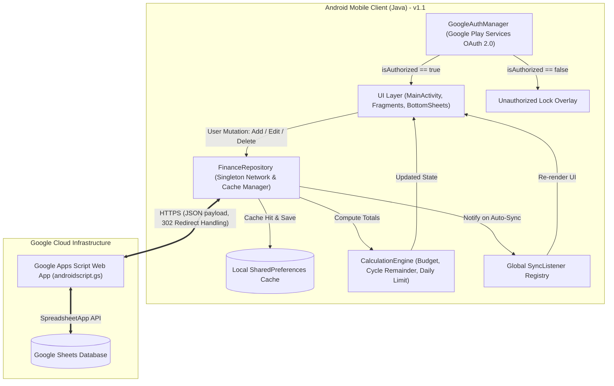
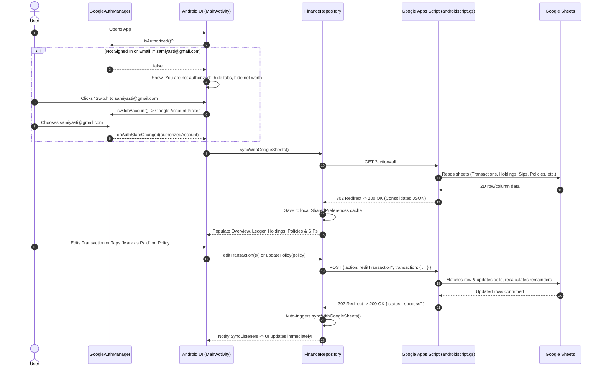
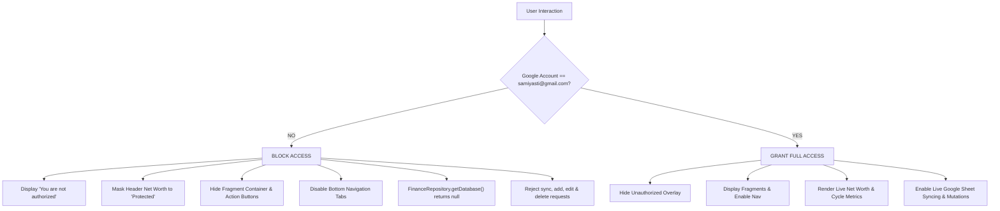

# Finance Manager - Comprehensive Architecture, Design & Developer Guide

A robust, offline-capable native Android application paired with a **Google Sheets REST API backend** (powered by Google Apps Script via `androidscript.gs`) to track, forecast, and manage personal wealth, monthly expense cycles, mutual fund portfolios, systematic investment plans (SIPs), insurance policies, and loan liabilities.

**Version:** `1.1` (`versionCode 2`)  
**Target SDK:** `Android 14 (API 34)` | **Min SDK:** `Android 8.0 (API 26)`  
**Ready-to-Install APK:** `FinanceManager.apk` (located in the repository root)

---

## Table of Contents
1. [Core Business Considerations & Domain Rules](#1-core-business-considerations--domain-rules)
   - [Google Account Authentication & Strict Authorization](#google-account-authentication--strict-authorization)
   - [Billing Cycle & The 6th-to-5th Rule](#billing-cycle--the-6th-to-5th-rule)
   - [Full Transaction Lifecycle: Add, Edit, Delete & Auto-Sync](#full-transaction-lifecycle-add-edit-delete--auto-sync)
   - [Running Balance (Remainder) Synchronization & Account Reconciliation](#running-balance-remainder-synchronization--account-reconciliation)
   - [Dual Sub-Category System](#dual-sub-category-system)
   - [SIP Tracer Architecture & Constraints](#sip-tracer-architecture--constraints)
   - [Financial Goals (View Only)](#financial-goals-view-only)
   - [LIC & Tata AIA Policies (Controlled Updates, 'Mark as Paid' & Add Flow)](#lic--tata-aia-policies)
   - [Insurance Financing Visual Representation (Health & Life Goal vs Policies)](#insurance-financing-visual-representation)
   - [Universal Custom Calendar Dialog V2 (Decades Quick-Jump & Min/Max Constraints)](#universal-custom-calendar-dialog-v2)
   - [Mutual Fund Transactions (Buy vs. Redeem)](#mutual-fund-transactions-buy-vs-redeem)
   - [Sheet Formula Co-existence](#sheet-formula-co-existence)
   - [Overview & Financial KPI Calculations](#overview--financial-kpi-calculations)
   - [Interactive Cycle Analytics Charts (Budget vs Expense vs Investment)](#interactive-cycle-analytics-charts)
   - [Cycle Expense Tracker (Past vs Current Cycle Comparison)](#cycle-expense-tracker-past-vs-current-cycle-comparison)
   - [App Branding & UX Modernization (Contextual Actions & Keyboard Handling)](#app-branding--ux-modernization)
2. [System Architecture & Data Flow](#2-system-architecture--data-flow)
   - [High-Level Architecture](#high-level-architecture)
   - [End-to-End Data Flow](#end-to-end-data-flow)
   - [Multi-Tier Authorization Flow](#multi-tier-authorization-flow)
   - [Handling Google Apps Script HTTP 302 Redirects](#handling-google-apps-script-http-302-redirects)
3. [Google Sheets Database Schema](#3-google-sheets-database-schema)
4. [Project File Structure](#4-project-file-structure)
5. [Key Components & Responsibilities](#5-key-components--responsibilities)
6. [Debugging & Troubleshooting Guide](#6-debugging--troubleshooting-guide)
   - [Building the Project](#building-the-project)
   - [Testing Google Apps Script Endpoints](#testing-google-apps-script-endpoints)
   - [Inspecting Logcat Logs](#inspecting-logcat-logs)
   - [Common Pitfalls & Fixes](#common-pitfalls--fixes)
7. [Google Apps Script Deployment Guide (`androidscript.gs`)](#7-google-apps-script-deployment-guide)

---

## 1. Core Business Considerations & Domain Rules

### Google Account Authentication & Strict Authorization
The application manages sensitive personal financial data, investment balances, and live transaction sync. It strictly enforces a single-user security model:
* **Authorized Identity**: Access to view or edit data is exclusively granted to:
  $$\mathbf{samiyasti@gmail.com}$$
* **Multi-Layer Enforcement Architecture**:
  1. **UI Layer (`MainActivity`)**:
     - When not signed in or signed in with any unauthorized Google account:
       - Displays a full-screen blocking overlay (`layoutUnauthorized`) with a red shield/lock icon (`ic_lock.xml`), **"You are not authorized"** title, and context-aware messaging.
       - The active fragment container is completely hidden (`View.GONE`).
       - Bottom navigation tabs are disabled (`setEnabled(false)`).
       - Contextual action buttons are disabled.
       - Header Net Worth displays `"Protected"` and Cycle info displays `"Access Restricted"`.
       - Provides a prominent `"Switch to samiyasti@gmail.com"` / `"Sign in with samiyasti@gmail.com"` button to invoke Google Play Services account chooser.
  2. **Dialog & Form Layer**:
     - Every bottom sheet modal (`AddTransactionBottomSheet`, `EditTransactionBottomSheet`, `AddMutualFundTransactionBottomSheet`, `EditSipBottomSheet`, `SipTracerBottomSheet`, `ViewMfTransactionsBottomSheet`, `EditPolicyBottomSheet`, `AddPolicyBottomSheet`) checks `GoogleAuthManager.isAuthorized()` in `onCreateView()`. If unauthorized, it immediately dismisses and displays a warning toast.
  3. **Repository Layer (`FinanceRepository`)**:
     - `getDatabase()` returns `null` when unauthorized, preventing cached financial numbers from leaking into memory or views.
     - All mutation methods (`addTransaction`, `editTransaction`, `deleteTransaction`, `addMutualFundTransaction`, `updateSip`, `updateSipStatus`, `updatePolicy`, `addPolicy`, `syncWithGoogleSheets`) reject calls immediately with an authorization error callback prior to initiating any network requests.
  4. **Authentication Manager (`GoogleAuthManager`)**:
     - Centralized singleton wrapping Google Play Services `GoogleSignInClient`.
     - Caches `GoogleSignInAccount` and notifies registered listeners (`AuthListener`) on auth state changes.
     - Implements `isAuthorized()` verifying `currentAccount != null && "samiyasti@gmail.com".equalsIgnoreCase(currentAccount.getEmail().trim())`.
     - Implements `switchAccount(activity)` which first calls `signOut()` so Google's native account chooser pops up reliably.

---

### Billing Cycle & The 6th-to-5th Rule
* **The Rule**: Monthly budget cycles run from the **6th of the current month to the 5th of the following month**.
* **Date 1 to 5 Boundary**:
  - Transactions dated between the **1st and 5th of Month M** belong to the **Month M-1 cycle**.
  - Transactions dated between the **6th and 31st of Month M** belong to the **Month M cycle**.
  - *Example*: A transaction on `02/11/2026` belongs to the **October 2026 cycle**, while a transaction on `07/11/2026` belongs to the **November 2026 cycle**.
* **Code Enforcement**: In `Transaction.java` and `CalculationEngine.java`, cycle assignment strictly inspects the numeric day and shifts the effective month:
  ```java
  public boolean isInCycle(int cycleYear, int cycleMonth) {
      int txDay = getDay();
      int txMonth = getMonth(); // 1-12
      int txYear = getYear();

      int effectiveMonth = (txDay < 6) ? (txMonth - 1) : txMonth;
      int effectiveYear = txYear;
      if (effectiveMonth == 0) {
          effectiveMonth = 12;
          effectiveYear--;
      }
      return effectiveYear == cycleYear && effectiveMonth == cycleMonth;
  }
  ```
  *(Never use string matching like `date.contains("11/2026")` because it erroneously assigns Nov 1-5 to the November cycle).*

---

### Full Transaction Lifecycle: Add, Edit, Delete & Auto-Sync
The application provides complete lifecycle management for all financial transactions:

1. **Adding Transactions (`AddTransactionBottomSheet`)**:
   - Allows recording Expense, Income, or Transfer transactions.
   - Date selection is powered by `CustomCalendarDialog`.
   - Category and Sub-Category picked via modal dialogs populated from `Category Tables`.
   - Account selection from active liquid bank accounts; Loan selection when repaying debts.
   - **Streamlined Fields**: The redundant free-form description input has been completely removed to match the updated spreadsheet schema (where Column 14 is reserved for budget processing flags).

2. **Editing Transactions (`EditTransactionBottomSheet`)**:
   - Tapping any transaction item in `LedgerFragment` opens the bottom sheet with all existing transaction data pre-populated.
   - All fields are editable: Date, Transaction Type (Expense/Income/Transfer), Sub-Category, Category, Account, Loan, and Amount.
   - Dynamic real-time calculation of Net and Remainder preview as amounts or types change.
   - Dispatches `action: 'editTransaction'` to `androidscript.gs`.
   - **Robust Row Lookup**: Identifies the exact row in Google Sheets by ID with fallback multi-attribute matching (Date + SubCategory + Account/Loan + Debit/Credit).

3. **Deleting Transactions**:
   - A dedicated **Delete Transaction** button in `EditTransactionBottomSheet` allows removing errant or cancelled entries.
   - Guarded by a confirmation dialog (`"Are you sure you want to delete this transaction?"`).
   - Dispatches `action: 'deleteTransaction'` to `androidscript.gs`, deleting the row from Google Sheets and triggering running balance recalculation.

4. **Global Real-Time Auto-Sync Engine**:
   - Every mutation (add transaction, edit transaction, delete transaction, update policy, add policy, update SIP) automatically triggers an immediate background `syncWithGoogleSheets()` upon HTTP success.
   - `FinanceRepository` maintains a `SyncListener` registry. Any data update notifies `MainActivity` and active fragments to re-render without requiring manual pull-to-refresh.

5. **Simplified Ledger Display**:
   - `TransactionsAdapter` presents transactions clearly with net amount, color-coded badges (`#34D399` for positive credit, `#F43F5E` for debit/expenses), account/loan labels, and formatted dates.

---

### Running Balance (Remainder) Synchronization & Account Reconciliation
* **Chronological Balance Integrity**:
  - Remainder represents the running balance of a bank account or outstanding balance of a loan after each transaction.
  - Toggling between Credit and Debit or editing historical transactions no longer corrupts balances.
* **Dual Opening Balance Feeds**:
  - Initial balances are sourced from `Account Opening Balance` and `Loans Opening Balance` sheets.
* **Server-Side Recalculation (`calculateRemainders()`)**:
  - `androidscript.gs` incorporates a batch recalculation routine that processes rows chronologically per account and per loan, correctly computing:
    $$\text{Balance}_{t} = \text{Balance}_{t-1} + \text{Credit} + \text{Debit} \quad (\text{Debit is signed negative})$$
  - Batch-updates Column E (`Remainder`) across the entire `Transactions` sheet in a single API operation.

---

### Dual Sub-Category System
The application distinguishes between two different concepts of "sub-category":

| Dimension | Scope | Examples | Used By |
|---|---|---|---|
| **Fund Asset Sub-Category** | Investment asset class | `Liquid`, `Flexi Cap`, `Small Cap`, `Mid Cap` | AMC classification |
| **Category Tables Sub-Category (Savings Type)** | Budgeting & account allocation | `Kuvera Surplus(Family)`, `Mutual Fund`, `Credit Mutual Fund` | Ledger transactions & Holding badges |

* **Holding Card Badge**: Displays `h.savingsType` (e.g. `Kuvera Surplus(Family)`).
* **Holding Click Filtering**: Clicking on a holding card (e.g. `DSP LIQUID FUND`) opens transaction history filtered by:
  1. Scheme Name / Scheme Code / Scheme Id.
  2. The Category Tables subcategory (`h.savingsType`), **not** the fund asset class (`Liquid`).

---

### SIP Tracer Architecture & Constraints
The SIP Tracer tracks systematic investment commitments across multiple platforms and bank accounts:
* **Dual Month View**: Monitors "This Month's SIP" vs "Next Month's SIP (Final)".
* **Controlled Creation**: New SIP entries **cannot** be added from the mobile app; they require direct Google Sheet entry.
* **Full In-App Modification**: Existing SIPs can be fully modified from the app:
  - This Month Amount & Next Month Amount (Numeric).
  - This Month & Next Month selections (`Jan`, `Feb`, ... `Dec`).
  - Payment Statuses (`Not Paid` / `Paid`).
  - Platform (`amc/upiauto`, `indmoney`, `amc/enach`, `groww`, `NA`).
  - Linked Bank Account (`Slice`, `sbi`, `Pnb`, `Hdfc`, etc.).
* **1-Tap Quick Toggles**: Main list cards have direct `Not Paid` / `Paid` buttons for fast 1-tap toggling without opening the full edit sheet.

---

### Financial Goals (View Only)
* **Design & Security Requirement**: Financial goals represent long-term wealth milestones and savings buckets (e.g. `Health And Life Insurance`, `Emergency Fund`, `Bike`).
* **Strict View-Only Rule**: Financial goals are strictly **view-only**. The mobile UI does not render edit, update, or delete buttons for goals.
* **Tracked Metrics**:
  - **Goal Target Amount**: Total planned fund accumulation (e.g. ₹60,000.00).
  - **Accumulated Balance**: Current sum saved towards the target (e.g. ₹15,190.28).
  - **Achieved Percentage**: Dynamic progress calculation ($$\text{Achieved} = \frac{\text{Current Amount}}{\text{Target Amount}} \times 100$$).
  - **Savings Allocation Percentage**: Planned monthly savings share (e.g. 30% of monthly savings).
  - **Visual Progress Bar**: Horizontal emerald progress bar showing completion toward goal target.

---

### LIC & Tata AIA Policies
The application tracks life, health, and vehicle insurance policies across LIC and Tata AIA Life Insurance:

* **13-Column Schema with Birth & Maturity Dates**:
  - Policy Number, Birth Date, Amount, Last Paid Date, Due Date, Maturity Date (Last Date), Installments Remaining (Formula), Sub-Category, Category, ID, Password, Sum Assured, Status / Notes.
* **Controlled Date Editor & 'Mark as Paid' (`EditPolicyBottomSheet`)**:
  - **Lockdown on Core Terms**: Policy Number, Premium Amount, Category, Sum Assured, and Notes remain locked to protect policy structure.
  - **'Mark as Paid' 1-Tap Action**:
    - Sets Last Paid Date to **Today** (`dd/MM/yyyy`).
    - Automatically advances Due Date by **+1 year** (e.g. `14/11/2026` $\rightarrow$ `14/11/2027`).
    - **Maturity Date Cap**: The advanced Due Date is strictly capped so it cannot exceed the policy's Maturity Date.
* **Strict Date Boundary Enforcement (`DateTimeHelper`)**:
  - **Last Paid Date**: Restricted to past or present dates only via `setupPastDatePicker`. Cannot select future dates.
  - **Due Date**: Restricted to present or future dates only via `setupFutureDatePicker`.
  - **Maturity Boundary**: Due date picker disables dates beyond policy maturity via `setupDueDatePicker`.
* **Add Policy Option (`AddPolicyBottomSheet`)**:
  - Fields: Policy Number, Birth Date, Due Date, Last Paid Date, Maturity Date, Premium Amount, Sum Assured, Sub-Category, Category, Notes.
  - **Auto-Calculated Installments**: Manual entry for "Installments Remaining" is removed; Google Sheet formulas automatically calculate remaining installments based on duration and payment frequency.
* **Dynamic Badges**: Policy cards in `AccountsFragment` display the actual policy sub-category as a badge instead of hardcoded labels.

---

### Insurance Financing Visual Representation
* **Business Logic**: The total annual insurance premiums across all active policies are financed by the `Health And Life Insurance` goal fund.
* **Visual Representation Card (Accounts Screen)**:
  - **3-Column KPI Metric Row**:
    1. **Annual Premiums** (Sky Blue `#38BDF8`): Sum of all active policy premiums ($$\sum \text{Policy Premiums} = \text{₹53,694.00}$$).
    2. **Funded in Goal** (Emerald `#34D399`): Accumulated balance in `Health And Life Insurance` goal ($$\text{₹15,190.28}$$).
    3. **Goal Target** (Amber `#F59E0B`): Full target capacity ($$\text{₹60,000.00}$$).
  - **Funding Percentage Badge**:
    $$\text{Funding \%} = \frac{\text{Goal Accumulated}}{\text{Total Annual Premiums}} \times 100 = 28.3\%$$
    - Styled with emerald badge (`bg_badge_good`) if $$\ge 100\%$$, or amber badge (`bg_badge_amber`) if underfunded.
  - **Progress Bar**: Horizontal visual progress bar comparing funded balance against total annual obligations.
  - **Dynamic Remaining Deficit Note**:
    - When underfunded: Displays exact shortage, e.g. *"₹38,503.72 remaining in goal to fully fund annual premiums"*.
    - When fully funded ($$\ge 100\%$$): Displays confirmation *"Annual insurance premiums are 100% funded by your Health & Life Goal!"*.

---

### Universal Custom Calendar Dialog V2
The custom calendar dialog (`CustomCalendarDialog.java` & `dialog_custom_calendar.xml`) delivers a desktop-grade date selection experience strictly styled to FinMngr's futuristic dark aesthetic:
* **Container & Header**: Deep navy rounded card (`#131B26`, 20dp corner radius, `#223247` border) with title and close button.
* **Quick Presets**: 1-tap shortcut pills:
  - `[ Today ]`
  - `[ Yesterday ]`
  - `[ 6th (Cycle Start) ]`
  - `[ 1st of Month ]`
* **Month & Year Picker Modal (`dialog_select_month_year.xml`)**:
  - **Decade Quick-Jump**: Horizontal selector bar allowing instant navigation across decades (from 1940 to 2070).
  - **Smooth Scrollable Year Grid**: Quick-pick any individual year (`item_calendar_year.xml`).
  - **12-Month Grid**: Immediate selection of target month.
* **7-Column Day Grid**: Day cells with haptic feedback. Today's date features a subtle mint ring (`#34D399`), and selected dates are highlighted with a solid emerald green circle (`#10B981`) and bold white text.
* **MinDate & MaxDate Constraints**: Smoothly disables unavailable dates (e.g. past dates for Due Date or future dates for Last Paid Date).
* **Formatting**: Formats selected dates strictly to `dd/MM/yyyy`.

---

### Mutual Fund Transactions (Buy vs. Redeem)
* **Buy / SIP**:
  - Positive units.
  - User enters Amount, NAV, and Units.
  - Amount is written to `Actual Invested` (Column 10).
* **Redeem**:
  - Negative units.
  - Amount is left blank or computed via sheet formula.

---

### Sheet Formula Co-existence
To prevent the mobile app from overwriting automated formulas in Google Sheets, specific columns are deliberately left blank in POST requests:
* **Column 1 (`Scheme Name`)**: Left blank so Google Sheet's `=VLOOKUP(Scheme Id, ...)` dynamically resolves the name.
* **Column 9 (`Invested / Redeemed Amount`)**: Left blank so sheet formulas (`=ROUND(Units * NAV, 2)`) calculate values.
* **Column 14 (`Processed / Scanned Flag`)**: Kept clean so backend budget scripts set `Done`.
* **Column 18 (`Scheme Code`)**: Sent for historical NAV sync lookups.

---

### Overview & Financial KPI Calculations
* **Net Worth Formula**:
  $$\text{Net Worth} = \sum \text{Bank Balances} + \sum \text{Mutual Fund Current Values} - \sum \text{Loan Outstanding}$$
* **Interest Accrued Rule**:
  Accrued interest aggregates bank account interest (`Category == "Interest"` and `Type == "Bank"`). It **strictly excludes** loan interest.
* **Balanced 2x2 Grid**: Overview cards are arranged in an unscrollable 2x2 grid:
  1. Net Worth (Total Valuation, 1D Gain, ROI)
  2. Bank Balances (Liquid funds across Slice, SBI, PNB, HDFC)
  3. Total Assets (Mutual funds, gold, equity)
  4. Loan Debt (Total liabilities)

---

### Interactive Cycle Analytics Charts
The Cycles screen features an interactive multi-series comparison chart (`CycleChartView`) comparing historical and active cycle metrics:
* **Metric Series**:
  - **Budget** (Sky Blue `#38BDF8`)
  - **Total Expense** (Rose Red `#F43F5E`)
  - **Total Investment** (Amber Gold `#F59E0B`)
* **Interactive Touch Scrubbing & Inspector**:
  - Users can tap or drag across cycles with immediate haptic feedback (`HapticFeedbackConstants.CLOCK_TICK`).
  - Active cycle indicator dot (Emerald `#10B981`) flags current billing cycle.
  - Interactive Selected Cycle Detail Card updates in real time with Budget, Actual Spend, % Utilized, Total Invested, and Net Surplus/Deficit.
* **Range & Series Filters**:
  - Filter by **6M** (Last 6 cycles), **1Y** (Last 12 cycles), or **All** historical cycles.
  - Interactive chip toggles allow isolating or hiding individual metric bars (Budget, Expense, Investment).
* **Live Sync**: Active cycle's expense and budget values dynamically reflect live transaction additions from `activeCycle.totalSpend` and `activeCycle.budget`.

---

### Cycle Expense Tracker (Past vs Current Cycle Comparison)
The **Expense Tracker** compares itemized spending and investments between the **past cycle** and **current active cycle**:
* **Savings vs. Expenses Business Rules**:
  - **Category of Saving** (e.g., Mutual Fund, Emergency Fund, US Stocks, NPS, PPF, LIC, Family Savings):
    $$\text{Current Cycle} \ge \text{Past Cycle} \implies \mathbf{Good\ /\ Better} \quad (\text{Emerald Badge: } \text{▲ Saved More})$$
    $$\text{Current Cycle} < \text{Past Cycle} \implies \mathbf{Alert} \quad (\text{Amber Badge: } \text{▼ Less Saved})$$
  - **Other Categories / Expenses** (e.g., Electricity, Food, Transit, House Rent, Mobile Bill, Family Expenses):
    $$\text{Current Cycle} \le \text{Past Cycle} \implies \mathbf{Good\ /\ Better} \quad (\text{Emerald Badge: } \text{▼ Reduced Expense})$$
    $$\text{Current Cycle} > \text{Past Cycle} \implies \mathbf{Alert} \quad (\text{Rose Red Badge: } \text{▲ Higher Expense})$$
* **Interactive Filtering & Summary**:
  - **Filter Tabs**: Toggle between **All Items**, **Savings**, and **Expenses**.
  - **Summary Counters**: Header displays live count of **On-Track/Good** vs. **Alert** items.
  - **Three-Column Metrics**: Each card presents **Current Cycle Cost**, **Past Cycle Cost**, and **Target / Budget** amount.
* **Backend Sync**:
  - Fetched from the `Expense Tracker` sheet in Google Sheets via `androidscript.gs` (`action=all`).
  - Automatically reconciled with active billing cycle transactions by `CalculationEngine`.

---

### App Branding & UX Modernization
* **Visual Identity**:
  - **Icon**: Stylized teal/cyan piggy bank with gold coin (`$`), bar chart graphic on body, and upward trending orange arrow inside a deep navy squircle (`#071727`).
  - **Logo Wordmark**: `FinMngr` typography with custom color split (**F** in `#FFFFFF`, **in** in `#1BB5A6`, **Mngr** in `#F59E0B`) with subtitle **SMART WEALTH TRACKING**.
* **Contextual Action Buttons (FAB Removal)**:
  - The floating action button (FAB) has been removed to maximize viewable screen space and avoid covering cards.
  - Contextual buttons are embedded cleanly in their respective screens:
    - **Ledger Screen**: Embedded `+ Record Transaction` button in toolbar/header.
    - **Holdings Screen**: Embedded `+ Add Investment` button.
    - **Accounts Screen**: Embedded `+ Add Policy` button.
* **Soft Keyboard Auto-Dismissal (`KeyboardHelper`)**:
  - Tapping the keyboard tick / Done action (`IME_ACTION_DONE`) immediately dismisses the keyboard and clears field focus.
  - Tapping anywhere outside input fields (card backgrounds, labels, containers, or scrolling) immediately hides the keyboard.
* **Modal Dialogs over Dropdowns**: Centered modal dialogs (`AlertDialog.Builder`) are used for picking months, platforms, and bank accounts, preventing layout jumping or keyboard overlap.

---

## 2. System Architecture & Data Flow

### High-Level Architecture



---

### End-to-End Data Flow



---

### Multi-Tier Authorization Flow



---

### Handling Google Apps Script HTTP 302 Redirects
When calling Google Apps Script Web Apps with a `POST` method:
1. Google Apps Script responds with `HTTP 302 Found` (or `303 See Other`) pointing to `https://script.googleusercontent.com/macros/echo?...`.
2. Standard Android `HttpURLConnection` does not automatically follow redirects across HTTP/HTTPS protocol transitions or POST-to-GET redirects.
3. `FinanceRepository.executeHttpPost()` explicitly captures `302/303` response codes, extracts the target URL from the `Location` header, establishes a new connection, and consumes the final response stream seamlessly.

---

## 3. Google Sheets Database Schema

The Google Spreadsheet acts as the relational database across 12 specialized sheets:

| Sheet Name | Key Columns | Purpose |
|---|---|---|
| **Transactions** | Date, Credit, Debit, Net, Remainder, Sub Category, Type, Loans, Account, Category, Year, Month, Debit Without Sign, Processed Flag | General ledger of all income and expenses (14 columns) |
| **Account Opening Balance** | Account Name, Opening Balance | Initial liquid account baseline for running balance calculations |
| **Loans Opening Balance** | Loan Name, Opening Balance | Initial liability baseline for running balance calculations |
| **Mutual Investment Holdings** | Scheme Name, Scheme Code, Scheme Id, Category, Sub-category, Savings Type, Units, Avg Buying NAV, Invested Value, NAV, Current Value, 1D Change | Current portfolio valuation and live NAV tracking |
| **Mutual Fund Transactions** | Scheme Name, Scheme Id, Date, Fund Category, Fund Sub Category, Platform, Sub Category, Folio, Actual Invested, Units, NAV, Processed, Scheme Code | Detailed mutual fund transaction ledger (Buy/Redeem) |
| **SIP Tracer** | Fund Name, Role in Architecture, This Month's SIP, This Month, Payment Status, Next SIP (Final), Next Month, Next Month's Payment Status, Linked Bank Account, Platform | Monthly SIP deployment roadmap and status |
| **Current Account Balance** | Accounts, Current Balance | Liquid bank account balances |
| **Current Loan OutStanding** | Loans, Current OutStanding, Interest Rate, IsDebt | Liabilities and debt tracking |
| **Budget** | Year, Month, Month Number, BUDGET, Spend, Remainder, Can Spend Per Day, Investment | Budget limits and daily spending allowances |
| **Category Tables** | Category Name, SubCategory | Category hierarchy definitions |
| **Goals** | Goals Name, Goal Amount, Occured Till Date, Percentage Of saving To Put | Long-term savings goals (View Only in app) |
| **LIC AND TATA AIA** | Policy Number, Birth Date, Amount, Last Paid, Due Date, Maturity Date (Last Date), Installment Remains (Formula), Sub Category, Category, Id, Password, Sum Assured, Status / Notes | Insurance policy master ledger (13 columns) |

---

## 4. Project File Structure

```
Finance-Manager/
├── .gitignore                          # Root ignore rules (build, gradle, IDE, apk)
├── FinanceManager.apk                  # Current ready-to-install build (v1.1)
├── README.md                           # This architecture and developer guide
├── google-apps-script/
│   └── androidscript.gs                # Google Apps Script Web App REST API gateway
└── finance-android/
    ├── build.gradle                    # Top-level Gradle configuration
    ├── gradlew / gradlew.bat           # Gradle wrapper scripts
    └── app/
        ├── build.gradle                # App module configuration (version 1.1, versionCode 2)
        └── src/main/
            ├── AndroidManifest.xml     # App manifest (INTERNET permission, MainActivity)
            ├── java/com/samiy/financemanager/
            │   ├── MainActivity.java   # Navigation activity (Auth Guard & Auto-Sync Listener)
            │   ├── auth/
            │   │   └── GoogleAuthManager.java # Google Play Services OAuth & Authorization logic
            │   ├── data/
            │   │   ├── FinanceRepository.java  # Core network client, cache & Google API sync
            │   │   └── model/                  # Data models (Gson serialized)
            │   │       ├── Account.java        # Bank account balance DTO
            │   │       ├── BudgetItem.java     # Budget & spend limits DTO
            │   │       ├── CategoryItem.java   # Category & subcategories DTO
            │   │       ├── CurrentCycle.java   # Billing cycle metadata DTO
            │   │       ├── FinanceDatabase.java# Consolidated in-memory database DTO
            │   │       ├── Holding.java        # Portfolio investment holding DTO
            │   │       ├── InsurancePolicy.java# Insurance policy DTO (Birth & Maturity dates)
            │   │       ├── Loan.java           # Liability DTO
            │   │       ├── MutualFundTransaction.java # MF transaction DTO
            │   │       ├── PortfolioSummary.java # Portfolio aggregated ROI DTO
            │   │       ├── SavingsTypeSummary.java # Savings category breakdown DTO
            │   │       ├── SipItem.java        # SIP Tracer item DTO
            │   │       └── Transaction.java    # General ledger entry DTO
            │   ├── engine/
            │   │   └── CalculationEngine.java  # Remainder, spend limit & interest aggregations
            │   ├── ui/
            │   │   ├── adapter/
            │   │   │   ├── AccountsAdapter.java
            │   │   │   ├── HoldingsAdapter.java
            │   │   │   ├── MfTransactionsAdapter.java
            │   │   │   ├── PoliciesAdapter.java
            │   │   │   ├── SipAdapter.java # SIP card adapter with 1-tap status buttons
            │   │   │   └── TransactionsAdapter.java # Simplified net amount transaction view
            │   │   ├── dialog/
            │   │   │   ├── AddMutualFundTransactionBottomSheet.java # Auth-guarded MF creator
            │   │   │   ├── AddPolicyBottomSheet.java                # New policy with date pickers
            │   │   │   ├── AddTransactionBottomSheet.java           # Auth-guarded transaction entry
            │   │   │   ├── CustomCalendarDialog.java                # Futuristic dark calendar dialog
            │   │   │   ├── EditPolicyBottomSheet.java               # Mark as Paid & policy editor
            │   │   │   ├── EditSipBottomSheet.java                  # Full SIP parameter editor
            │   │   │   ├── EditTransactionBottomSheet.java          # Edit & Delete transaction modal
            │   │   │   ├── SipTracerBottomSheet.java                # SIP list & quick status toggler
            │   │   │   └── ViewMfTransactionsBottomSheet.java       # MF ledger filtered by holding
            │   │   └── fragment/
            │   │       ├── AccountsFragment.java   # Bank balances, debts, goals & policies
            │   │       ├── CycleFragment.java      # Expense tracker & cycle analytics chart
            │   │       ├── HoldingsFragment.java   # Portfolio summary & scheme cards
            │   │       ├── LedgerFragment.java     # Transaction history, edit/delete & filters
            │   │       └── OverviewFragment.java   # 2x2 financial KPI dashboard
            │   └── util/
            │       ├── DateTimeHelper.java     # Date parsing & min/max boundary validators
            │       └── KeyboardHelper.java     # Soft keyboard auto-dismissal on IME Done
            └── res/
                ├── drawable/                   # Dark theme backgrounds, chips & pills
                │   ├── ic_lock.xml             # Security padlock vector for auth screen
                │   ├── ic_google.xml           # Multi-color official Google 'G' icon
                │   └── ...
                ├── layout/                     # XML layout resources
                │   ├── activity_main.xml       # Main layout with Unauthorized blocking overlay
                │   ├── dialog_custom_calendar.xml # Custom dark-themed calendar layout
                │   ├── dialog_edit_policy.xml  # Policy editor with 'Mark as Paid'
                │   ├── dialog_edit_sip.xml     # Clean edit dialog with touch interceptor
                │   ├── dialog_edit_transaction.xml # Edit & Delete transaction bottom sheet
                │   ├── dialog_select_month_year.xml # Decades quick-jump & month/year selector
                │   ├── item_calendar_year.xml  # Year item for calendar selector
                │   ├── fragment_accounts.xml   # Section filter pills & insurance visualizer
                │   ├── fragment_ledger.xml     # Ledger with contextual transaction button
                │   └── ...
                └── values/
                    ├── colors.xml              # Futuristic dark palette (#0B0F19, emerald, red)
                    ├── strings.xml
                    └── styles.xml              # AppTheme & CustomDarkDialog definitions
```

---

## 5. Key Components & Responsibilities

| Component | Responsibility |
|---|---|
| `GoogleAuthManager` | Manages Google Sign-In with Google Play Services (`GoogleSignInClient`). Validates authorization against `samiyasti@gmail.com`, notifies listeners on login/logout, and provides safe account switching. |
| `MainActivity` | Orchestrates top-level navigation, bottom navigation tabs, manages authorization blocking overlay, and subscribes to `FinanceRepository` auto-sync notifications to refresh header KPIs and active fragments. |
| `FinanceRepository` | Singleton network and cache manager. Implements API endpoints (`addTransaction`, `editTransaction`, `deleteTransaction`, `updatePolicy`, `addPolicy`, `updateSip`, `syncWithGoogleSheets`). Triggers automated background syncs on all mutations. |
| `EditTransactionBottomSheet` | Pre-fills transaction details for editing (Date, Type, Category, Sub-Category, Account, Loan, Amount) and provides 1-tap Delete Transaction action with confirmation. |
| `KeyboardHelper` | Central utility attaching IME Done/Tick action listeners to edit fields and providing instant soft keyboard dismissal. |
| `CalculationEngine` | Computes net inflow/outflow, total debit/credit, remaining budget, days remaining in cycle, daily spend allowance, and filters interest transactions. |
| `AccountsFragment` | Renders bank balances, liabilities/debt, section filter pills (All, Banks & Debt, LIC & Tata AIA, Financial Goals), Insurance Financing visual representation card, insurance policy list with date updates and add policy action, and view-only financial goals. |
| `EditPolicyBottomSheet` | Bottom sheet for updating insurance policies. Strictly enforces lockdown on policy terms; provides 1-tap **'Mark as Paid'** (advancing due date by +1 yr, capped by maturity) and dark-themed calendar pickers. |
| `AddPolicyBottomSheet` | Allows adding new insurance policies to Google Sheets with calendar pickers for Birth Date, Due Date, Last Paid Date, and Maturity Date (installments calculated by sheet formula). |
| `CustomCalendarDialog` | Custom dark-themed calendar dialog featuring 1-tap presets (Today, Yesterday, 6th Cycle Start, 1st of Month), decade quick-jumps (1940-2070), and month/year grid modal adhering to FinMngr design language. |
| `DateTimeHelper` | Central utility managing calendar date picker dialogs, date string parsing/formatting in `dd/MM/yyyy`, and min/max date boundary validators (`setupPastDatePicker`, `setupFutureDatePicker`, `setupDueDatePicker`). |
| `HoldingsFragment` | Renders portfolio KPIs (total invested, current valuation, 1D gain, ROI), savings type breakdown, and the list of holdings. |
| `ViewMfTransactionsBottomSheet` | Displays mutual fund transaction history. Filters by Scheme Name/Id/Code and Category Tables Sub-Category (`Kuvera Surplus(Family)`). Protected by authorization checks. |
| `SipTracerBottomSheet` | Displays active SIP schemes, total monthly outlay, quick `Paid`/`Not Paid` toggle buttons, and opens the full editor. Protected by authorization checks. |
| `EditSipBottomSheet` | Edits SIP amounts, months, payment statuses, platforms, and linked bank accounts with auto-dismiss keyboard touch listeners. Protected by authorization checks. |
| `LedgerFragment` | Full transaction history with cycle dropdown selector, account filtering, debit/credit summaries, contextual `+ Record Transaction` action, and tap-to-edit interactions. |

---

## 6. Debugging & Troubleshooting Guide

### Building the Project
From the repository root or `finance-android` directory:

```powershell
Set-Location "finance-android"
./gradlew assembleDebug --no-daemon
```

The generated APK is located at:
`C:\Users\samiy\AppData\Local\Temp\FinanceManagerBuild\app\outputs\apk\debug\app-debug.apk`

*(And automatically mirrored to `FinanceManager.apk` in the repository root for immediate distribution).*

---

### Testing Google Apps Script Endpoints
To verify the live Google Apps Script Web App without running the Android app:

#### 1. Test GET (Fetch Entire Database):
```bash
node -e "fetch('YOUR_GAS_URL?action=all', {redirect: 'follow'}).then(r => r.json()).then(d => console.log('Keys:', Object.keys(d.data), 'Transactions count:', d.data.transactions.length))"
```

#### 2. Test POST (Edit a Transaction):
```javascript
fetch('YOUR_GAS_URL', {
  method: 'POST',
  headers: { 'Content-Type': 'application/json' },
  body: JSON.stringify({
    action: 'editTransaction',
    transaction: {
      id: 105,
      date: '08/11/2026',
      subCategory: 'Food',
      type: 'Expense',
      account: 'Slice',
      debitWithoutSign: 250,
      debit: -250,
      credit: 0
    }
  }),
  redirect: 'follow'
}).then(r => r.json()).then(console.log);
```

#### 3. Test POST (Recalculate Remainders):
```bash
node -e "fetch('YOUR_GAS_URL?action=recalculateRemainders', {redirect: 'follow'}).then(r => r.json()).then(console.log)"
```

---

### Inspecting Logcat Logs
Connect your device over ADB and filter by app tags:
```bash
adb logcat -s FinanceRepository CalculationEngine GoogleAuthManager MainActivity
```

---

### Common Pitfalls & Fixes

1. **"You are not authorized" Shown When Opening the App**:
   - *Cause*: User is not logged into Google, or logged into another email account instead of `samiyasti@gmail.com`.
   - *Fix*: Tap the **"Switch to samiyasti@gmail.com"** or **"Sign in with samiyasti@gmail.com"** button and select the authorized account.
   - *Google Play Services API Error*: Ensure your debug SHA-1 signing fingerprint is registered in Google Cloud Console OAuth 2.0 Client IDs for package `com.samiy.financemanager`.

2. **Transactions on Date 1-5 Appearing in Wrong Cycle**:
   - *Cause*: String matching on date (e.g. `date.contains("11/2026")`).
   - *Fix*: Always use `Transaction.isInCycle(cycleYear, cycleMonth)` which checks `day < 6 ? month - 1 : month`.

3. **Transaction Running Balances (Remainder) Desynchronized**:
   - *Cause*: Manual row edits in Google Sheets or missing opening balance definitions.
   - *Fix*: Ensure `Account Opening Balance` and `Loans Opening Balance` have correct entries, then invoke `recalculateRemainders` in `androidscript.gs`.

4. **Policy Due Date Cannot Be Selected**:
   - *Cause*: The chosen date violates the boundary rule (e.g., date is in the past, or date exceeds policy Maturity Date).
   - *Fix*: Select a date between Today and the policy's Maturity Date.

5. **Software Keyboard Blocks Dialog Fields or Buttons**:
   - *Cause*: Missing `SOFT_INPUT_ADJUST_RESIZE` or bottom sheet collapsing.
   - *Fix*: Bottom sheets use `behavior.setState(STATE_EXPANDED)` and `behavior.setSkipCollapsed(true)` along with `KeyboardHelper.setupDoneAction(...)`.

6. **Dropdown Menus Flying to the Top of the Screen**:
   - *Cause*: Standard Android `Spinner` calculates popup coordinates incorrectly in scrollable bottom sheets.
   - *Fix*: Use centered modal dialogs (`AlertDialog.Builder`) for picking months, platforms, categories, and banks.

---

## 7. Google Apps Script Deployment Guide

Whenever modifying `androidscript.gs`:
1. Open the [Finance Report Google Sheet](https://docs.google.com/spreadsheets/d/1IUekkxG3Au1ZBO5wOkk8Tit6ZZAuLhjiJjlKpTaUg_A/edit).
2. Click **Extensions** > **Apps Script**.
3. Replace the entire code with the contents of `google-apps-script/androidscript.gs`.
4. Click **Deploy** > **Manage deployments** (or **New deployment**).
5. Configuration:
   - **Type**: Web app
   - **Execute as**: `Me` (your Google account)
   - **Who has access**: `Anyone`
6. Click **Deploy**.
7. If the deployment URL changes, update `GAS_URL` in `FinanceRepository.java` and recompile.
