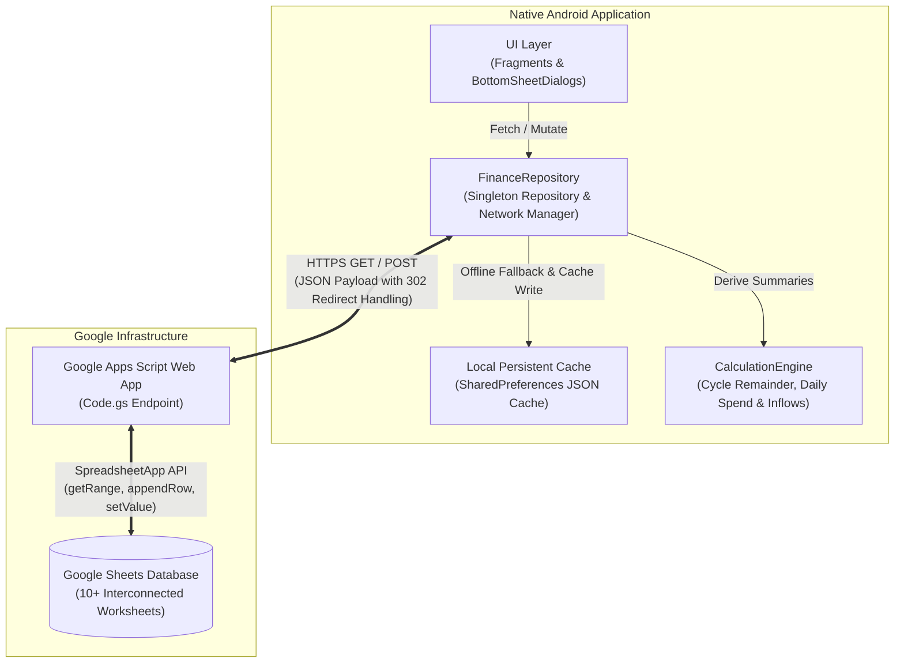
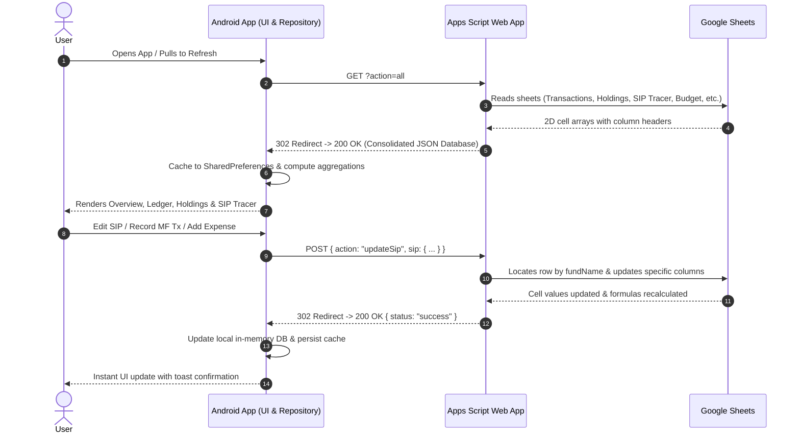

# 🚀 Finance Manager — Architecture, Design & Developer Guide

A robust, offline-capable native Android application paired with a **Google Sheets REST API backend** (powered by Google Apps Script) to track, forecast, and manage personal wealth, monthly expense cycles, mutual fund portfolios, systematic investment plans (SIPs), and loan liabilities.

---

## 📑 Table of Contents
1. [System Architecture](#-system-architecture)
2. [Data Flow & Communication Protocol](#-data-flow--communication-protocol)
3. [Core Business Concepts & Domain Logic](#-core-business-concepts--domain-logic)
   - [1. Monthly Billing Cycles (The 6th-to-5th Rule)](#1-monthly-billing-cycles-the-6th-to-5th-rule)
   - [2. Dual Sub-Category Concept (Category Tables vs Fund Class)](#2-dual-sub-category-concept-category-tables-vs-fund-class)
   - [3. SIP Tracer & Deployment Architecture](#3-sip-tracer--deployment-architecture)
   - [4. Mutual Fund Transactions (Buy vs. Redeem)](#4-mutual-fund-transactions-buy-vs-redeem)
   - [5. Overview Dashboard & Net Worth Metrics](#5-overview-dashboard--net-worth-metrics)
4. [Project Directory & File Structure](#-project-directory--file-structure)
5. [Key Classes & Component Responsibilities](#-key-classes--component-responsibilities)
6. [Google Sheets & Apps Script Backend (`Code.gs`)](#-google-sheets--apps-script-backend-codegs)
7. [Debugging & Troubleshooting Guide](#-debugging--troubleshooting-guide)
8. [Build & Deployment Instructions](#-build--deployment-instructions)

---

## 🏛 System Architecture

The application is structured around a decoupled **Client-Server-Spreadsheet** architecture:



### Architectural Highlights
- **Zero Cloud Hosting Costs**: Google Sheets acts as the database engine with formula execution, while Google Apps Script acts as the serverless REST API gateway.
- **Offline-First Resilience**: All sheet data is cached in local app storage via Gson. If the network is unavailable, the user can inspect their finances without interruption.
- **Formula Co-existence**: The backend leaves specific columns blank (`Scheme Name`, `Invested / Redeemed Amount`, `Processed`) so that Google Sheets formulas (such as `ROUND(Units * NAV, 2)`) automatically populate values without interference.

---

## 🔄 Data Flow & Communication Protocol



### Handling Google Apps Script 302 Redirects
When executing `POST` operations against a deployed Google Apps Script Web App:
1. Google responds with `HTTP 302 Found` and provides a redirect URL pointing to `https://script.googleusercontent.com/macros/echo?...`.
2. Standard Android `HttpURLConnection` disables automatic redirects for POST methods.
3. The custom `executeHttpPost()` in `FinanceRepository` intercepts `302/303` redirects and forwards the JSON payload or checks execution status cleanly.

---

## 💡 Core Business Concepts & Domain Logic

### 1. Monthly Billing Cycles (The 6th-to-5th Rule)
- Unlike calendar months (1st to 30th/31st), the personal finance budget runs on a **cycle from the 6th of the current month to the 5th of the next month**.
- **Critical Boundary Rule**:
  - Transactions dated **1st to 5th of Month $M$** belong to the **Month $M-1$ cycle**.
  - Transactions dated **6th to 31st of Month $M$** belong to the **Month $M$ cycle**.
  - *Example*: A transaction on `02/11/2026` belongs to the **October 2026 cycle**, whereas `07/11/2026` belongs to the **November 2026 cycle**.
- **Implementation**: Enforced strictly in `Transaction.java` and `CalculationEngine.java`:
  ```java
  public boolean isInCycle(int cycleYear, int cycleMonth) {
      int txDay = getDay();
      int txMonth = getMonth(); // 1-12
      int txYear = getYear();

      int effectiveMonth = (txDay < 6) ? (txMonth - 1) : txMonth;
      int effectiveYear = txYear;
      if (effectiveMonth == 0) {
          effectiveMonth = 12;
          effectiveYear--;
      }
      return effectiveYear == cycleYear && effectiveMonth == cycleMonth;
  }
  ```
  *(Never use substring checks like `date.contains("11/2026")` as they cause 1st–5th transactions to bleed into the wrong cycle).*

---

### 2. Dual Sub-Category Concept (Category Tables vs Fund Class)
The project utilizes two distinct sub-category dimensions:

| Dimension | Scope | Examples | Used In |
|---|---|---|---|
| **Fund Asset Sub-Category** | Mutual Fund Asset Class | `Liquid`, `Flexi Cap`, `Small Cap`, `Mid Cap` | Portfolio classification |
| **Category Table Sub-Category (Savings Type)** | Budgeting & Category Allocation | `Kuvera Surplus(Family)`, `Mutual Fund`, `Credit Mutual Fund` | Ledger transactions & Holding badges |

* **Holding Card Badge**: Renders `h.savingsType` (e.g. `Kuvera Surplus(Family)`).
* **Clicking a Holding**: When tapping a holding (e.g. `DSP LIQUID FUND`), the transaction dialog filters by:
  1. `schemeName` (matching scheme ID or scheme Code).
  2. `subCategory` from Category Tables (`h.savingsType`), **not** the fund asset sub-category (`Liquid`).

---

### 3. SIP Tracer & Deployment Architecture
The SIP Tracer monitors monthly automated mutual fund investments across deployment platforms and linked bank accounts.

#### Column Mapping in `SIP Tracer` Sheet:
| Col # | Sheet Column Header | Description / Allowed Values |
|---|---|---|
| 1 | `Fund Name` | Unique scheme name (used as key for lookups) |
| 2 | `Role in Architecture` | Architectural role badge (`Aggressor`, `Emergency Corpus Build`, etc.) |
| 3 | `This Month's SIP` | Numeric SIP amount for the current active cycle |
| 4 | `This Month` | 3-letter month abbreviation (`Jan`, `Feb`, ... `Dec`) |
| 5 | `Payment Status` | `Paid` or `Not Paid` |
| 6 | `Next SIP (Final)` | Numeric SIP target amount for next cycle |
| 7 | `Next Month` | 3-letter month abbreviation (`Jan`, `Feb`, ... `Dec`) |
| 8 | `Next Month's Payment Status` | `Paid` or `Not Paid` |
| 9 | `Linked Bank Account` | `Slice`, `sbi`, `Pnb`, `Hdfc`, etc. |
| 10 | `Platform` | `amc/upiauto`, `indmoney`, `amc/enach`, `groww`, `NA` |

#### User Constraints:
- **No In-App Additions**: The user cannot add new SIP entries from the mobile app. New funds must be created directly in the Google Sheet.
- **Full In-App Modifications**: All parameters (amounts, months, platform, bank, payment status) can be updated from the app via `EditSipBottomSheet`.
- **1-Tap Quick Toggles**: On the main SIP Tracer card list, `Paid` / `Not Paid` buttons can be tapped directly for fast status flipping without opening the full edit sheet.
- **Dismiss Keyboard on Touch**: Touching anywhere outside of an active numeric input immediately dismisses the software keyboard.
- **Centered Modal Pickers**: Month, Platform, and Bank Account options open in centered dark modal dialogs to prevent awkward floating popups or keyboard displacement.

---

### 4. Mutual Fund Transactions (Buy vs. Redeem)
- **Sheet**: `Mutual Fund Transactions`
- **18-Column Schema**:
  1. `Scheme Name` *(left empty; populated by sheet VLOOKUP formula)*
  2. `Scheme Id`
  3. `Date` (`dd/MM/yyyy`)
  4. `Fund Category` (e.g. `Equity`, `Debt`)
  5. `Fund Sub Category` (e.g. `Small Cap`, `Liquid`)
  6. `Platform` (e.g. `Groww`, `Kuvera`, `Zerodha`)
  7. `Sub Category` (Category Table subcategory, e.g. `Mutual Fund`, `Kuvera Surplus(Family)`)
  8. `Folio Number`
  9. `Invested / Redeemed Amount` *(kept empty or computed by formula)*
  10. `Actual Invested` *(Buy amount; empty on redeem)*
  11. `Cost` *(empty)*
  12. `Units` *(positive on Buy, negative on Redeem)*
  13. `Buy NAV/Reedem NAV`
  14. `Current NAV`
  15. `P&L` *(empty)*
  16. `Days Invested` *(empty)*
  17. `Processed` *(left empty; sheet marks this 'Done' via script)*
  18. `Scheme Code`

---

### 5. Overview Dashboard & Net Worth Metrics
- **Net Worth Calculation**:
  $$\text{Net Worth} = \sum \text{Bank Balances} + \sum \text{Investments (NAV Value)} - \sum \text{Debt (Loans)}$$
- **Interest Accrued Consideration**:
  Interest accrued counts interest received across bank accounts (`Category == "Interest"` and `Type == "Bank"`). It **excludes** interest from loans or liabilities.
- **2x2 Balanced Overview Grid**:
  - Card 1: **Net Worth** (Total Valuation, 1D Gain, ROI)
  - Card 2: **Bank Balances** (Liquid cash across Slice, SBI, PNB, HDFC)
  - Card 3: **Total Assets** (Mutual funds, gold, equity)
  - Card 4: **Loan Debt** (Outstanding liabilities)

---

## 📁 Project Directory & File Structure

```
Finance-Manager/
├── FinanceManager.apk                          # Current production debug build
├── google-apps-script/
│   └── Code.gs                                 # Google Apps Script Web App REST API
└── finance-android/
    ├── gradlew / gradlew.bat                   # Gradle wrapper
    ├── build.gradle                            # Top-level Gradle script
    └── app/
        ├── build.gradle                        # App dependencies, compile SDK, build config
        └── src/main/
            ├── AndroidManifest.xml             # Permissions (INTERNET), activities, launcher
            ├── java/com/samiy/financemanager/
            │   ├── MainActivity.java           # Bottom navigation controller & fragment container
            │   ├── data/
            │   │   ├── FinanceRepository.java  # HTTP client, cache, Google Sheets synchronization
            │   │   └── model/                  # Data Transfer Objects (Gson serialized)
            │   │       ├── Account.java        # Bank account balance model
            │   │       ├── BudgetItem.java     # Monthly budget & daily limit model
            │   │       ├── CategoryItem.java   # Category & SubCategory mappings
            │   │       ├── CurrentCycle.java   # Active billing cycle model
            │   │       ├── FinanceDatabase.java# Consolidated in-memory database
            │   │       ├── Holding.java        # Mutual fund portfolio holding
            │   │       ├── Loan.java           # Liability & loan outstanding
            │   │       ├── MutualFundTransaction.java # MF transaction model
            │   │       ├── PortfolioSummary.java # Aggregated portfolio returns & 1D change
            │   │       ├── SavingsTypeSummary.java # Savings category breakdown
            │   │       ├── SipItem.java        # SIP Tracer model
            │   │       └── Transaction.java    # General ledger entry model
            │   ├── engine/
            │   │   └── CalculationEngine.java  # Budget remainder, daily limits, cycle checks
            │   ├── ui/
            │   │   ├── adapter/
            │   │   │   ├── AccountsAdapter.java
            │   │   │   ├── HoldingsAdapter.java
            │   │   │   ├── MfTransactionsAdapter.java
            │   │   │   ├── SipAdapter.java
            │   │   │   └── TransactionsAdapter.java
            │   │   ├── dialog/
            │   │   │   ├── AddMutualFundTransactionBottomSheet.java
            │   │   │   ├── AddTransactionBottomSheet.java
            │   │   │   ├── EditSipBottomSheet.java # Full parameter SIP editor
            │   │   │   ├── SipTracerBottomSheet.java # SIP list & quick status toggler
            │   │   │   └── ViewMfTransactionsBottomSheet.java # MF transaction filtered ledger
            │   │   └── fragment/
            │   │       ├── AccountsFragment.java
            │   │       ├── CycleFragment.java
            │   │       ├── HoldingsFragment.java   # Portfolio overview & scheme list
            │   │       ├── LedgerFragment.java     # Complete transaction history
            │   │       └── OverviewFragment.java   # 2x2 financial KPI dashboard
            │   └── util/
            │       └── DateTimeHelper.java     # Date parsing (dd/MM/yyyy) & cycle utilities
            └── res/
                ├── drawable/                   # Custom dark-theme backgrounds, pills & shapes
                ├── layout/                     # XML layout designs
                │   ├── dialog_edit_sip.xml     # Clean dialog layout with auto-closing keyboard
                │   ├── dialog_sip_tracer.xml   # SIP Tracer bottom sheet layout
                │   ├── dialog_view_mf_transactions.xml
                │   ├── fragment_holdings.xml   # Balanced 2x2 header button layout
                │   ├── fragment_overview.xml   # 2x2 KPI card grid
                │   ├── item_holding.xml
                │   ├── item_sip.xml
                │   └── item_transaction.xml
                └── values/
                    ├── colors.xml              # Futuristic dark palette (#0B0F19, emerald, royal blue)
                    ├── strings.xml
                    └── styles.xml              # AppTheme & CustomDarkDialog definitions
```

---

## 🧩 Key Classes & Component Responsibilities

| Class | Responsibility |
|---|---|
| `FinanceRepository` | Thread-pool executor for API calls (`executeHttpGetWithRedirect`, `executeHttpPost`), manages `GAS_URL`, persists JSON cache in `SharedPreferences`. |
| `CalculationEngine` | Computes live cycle debit/credit totals, daily spend limits, remaining days in active cycle, and interest accrued. |
| `HoldingsFragment` | Displays total invested, current valuation, 1-day gain, ROI, savings type breakdown, and the list of active holdings. |
| `ViewMfTransactionsBottomSheet` | Multi-filter mutual fund ledger (filter by Scheme, Category, Category Table Sub-Category, and Buy vs. Redeem). |
| `SipTracerBottomSheet` | Displays total monthly SIP outlay, active SIP cards, 1-tap `Paid`/`Not Paid` status buttons, and edit button. |
| `EditSipBottomSheet` | Allows editing both monthly amounts, months, payment statuses, platforms, and linked bank accounts with auto-dismiss keyboard logic. |
| `LedgerFragment` | Displays all general transactions with month-cycle filtering, account filtering, and debit/credit summaries. |

---

## ⚡ Google Sheets & Apps Script Backend (`Code.gs`)

The script deployed on Google Apps Script turns your Google Spreadsheet into a full REST API:

### GET Request: `?action=all`
Returns all sheets packed into a single JSON object:
```json
{
  "status": "success",
  "data": {
    "accounts": [ ... ],
    "loans": [ ... ],
    "budget": [ ... ],
    "goals": [ ... ],
    "holdings": [ ... ],
    "mutualFundTransactions": [ ... ],
    "insurance": [ ... ],
    "sips": [ ... ],
    "categories": [ ... ],
    "transactions": [ ... ]
  }
}
```

### POST Actions Supported in `Code.gs`:
1. `addTransaction`: Appends a row to the `Transactions` sheet and triggers `calculateRemainders()`.
2. `updateSipStatus`: Fast toggle for single-field status (`current` or `next`) in `SIP Tracer`.
3. `updateSip`: Updates all parameters (`currentSip`, `currentMonth`, `currentStatus`, `nextSip`, `nextMonth`, `nextStatus`, `bankAccount`, `platform`) for a given fund name.
4. `addMutualFundTransaction`: Appends an 18-column record to `Mutual Fund Transactions`.
5. `addHolding`: Appends an investment scheme to `Mutual Investment Holdings`.

---

## 🛠 Debugging & Troubleshooting Guide

### 1. Verification of Backend API
To test if the Google Apps Script Web App is reachable and returning data:
```bash
node -e "fetch('YOUR_GAS_URL?action=all', {redirect: 'follow'}).then(r => r.json()).then(d => console.log('Keys:', Object.keys(d.data)))"
```

### 2. Testing POST Mutations
To test if a POST action updates the Google Sheet directly:
```javascript
fetch('YOUR_GAS_URL', {
  method: 'POST',
  headers: { 'Content-Type': 'application/json' },
  body: JSON.stringify({
    action: 'updateSip',
    sip: {
      fundName: 'Invesco India Mid Cap',
      currentSip: 4500,
      currentMonth: 'Nov',
      currentStatus: 'Paid',
      nextSip: 4500,
      nextMonth: 'Dec',
      nextStatus: 'Not Paid',
      bankAccount: 'Slice',
      platform: 'amc/upiauto'
    }
  }),
  redirect: 'follow'
}).then(r => r.json()).then(console.log);
```

### 3. Logcat Inspection
Connect your device over ADB and filter by app tags:
```bash
adb logcat -s FinanceRepository CalculationEngine
```

### 4. Common Issues & Solutions
| Issue | Root Cause | Solution |
|---|---|---|
| Transactions from 1st–5th showing under current month | Hardcoded string matching on date (`11/2026`) | Use `Transaction.isInCycle(year, month)` which subtracts 1 from month if `day < 6`. |
| Changes in SIP not saving to sheet | Missing `updateSip` action in deployed Apps Script | Deploy new version of `Code.gs` via **Deploy > New deployment** in Google Apps Script. |
| Keyboard obscures Save button | Missing `ADJUST_RESIZE` or collapsed bottom sheet | Set `behavior.setState(STATE_EXPANDED)` and `setSoftInputMode(SOFT_INPUT_ADJUST_RESIZE)`. |
| Dropdown menus shooting off screen | Standard spinner coordinate bugs in nested scroll views | Use `AlertDialog.Builder` modal pickers (`showSingleChoiceDialog`). |
| Holding transactions not appearing | Filter matched Fund Sub-Category instead of Category Tables Sub-Category | Pass `h.savingsType` into `ViewMfTransactionsBottomSheet.newInstance(...)`. |

---

## 📦 Build & Deployment Instructions

### Building the Debug APK
Navigate to the Android project folder and run Gradle:
```powershell
Set-Location "C:\Users\samiy\OneDrive\Documents\projects\android\Finance-Manager\finance-android"
./gradlew assembleDebug --no-daemon
```

The compiled APK will be generated at:
`finance-android\app\build\outputs\apk\debug\app-debug.apk`
(and automatically copied to root `FinanceManager.apk`).

### Updating the Google Apps Script
1. Open your Google Sheet.
2. Navigate to **Extensions** > **Apps Script**.
3. Replace the entire code with the contents of [Code.gs](file:///C:/Users/samiy/OneDrive/Documents/projects/android/Finance-Manager/google-apps-script/Code.gs).
4. Click **Deploy** > **Manage deployments** (or **New deployment**).
5. Ensure *Execute as* is set to **Me** and *Who has access* is set to **Anyone**.
6. Copy the Web App URL (if changed) into `FinanceRepository.java` (`GAS_URL`).
